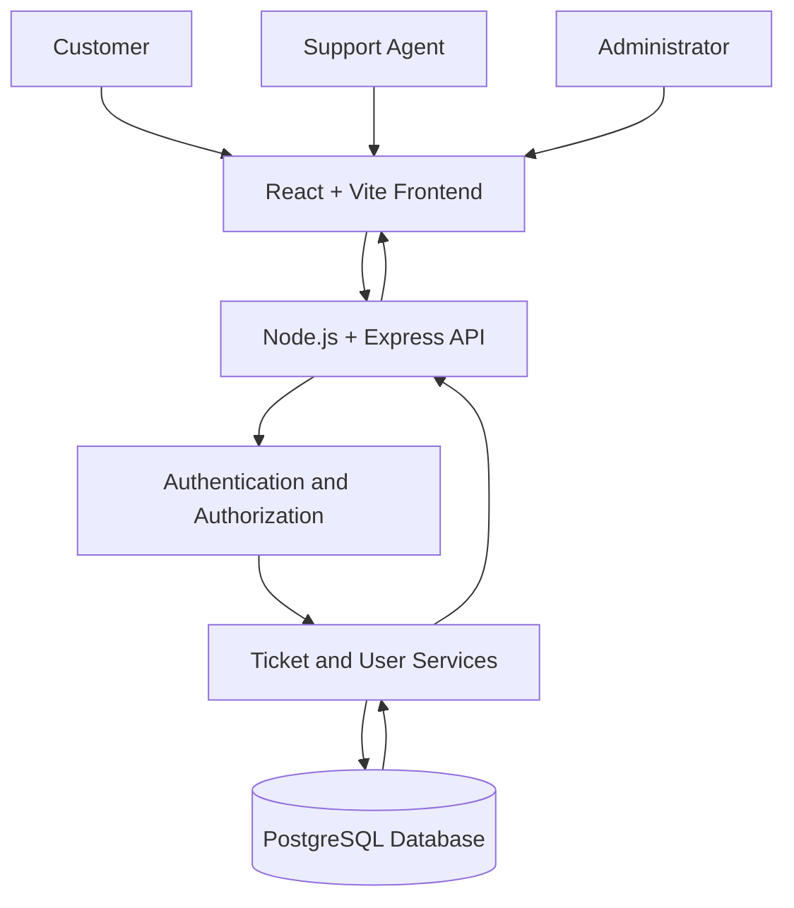
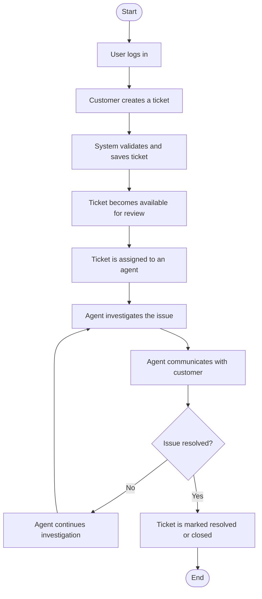
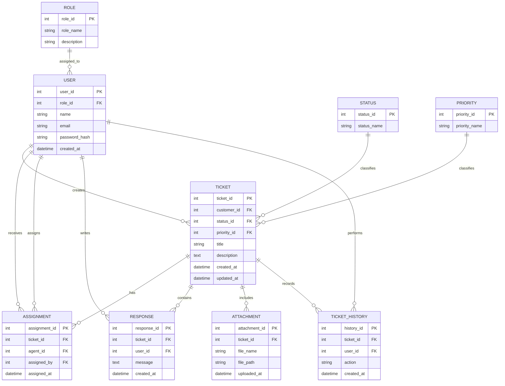
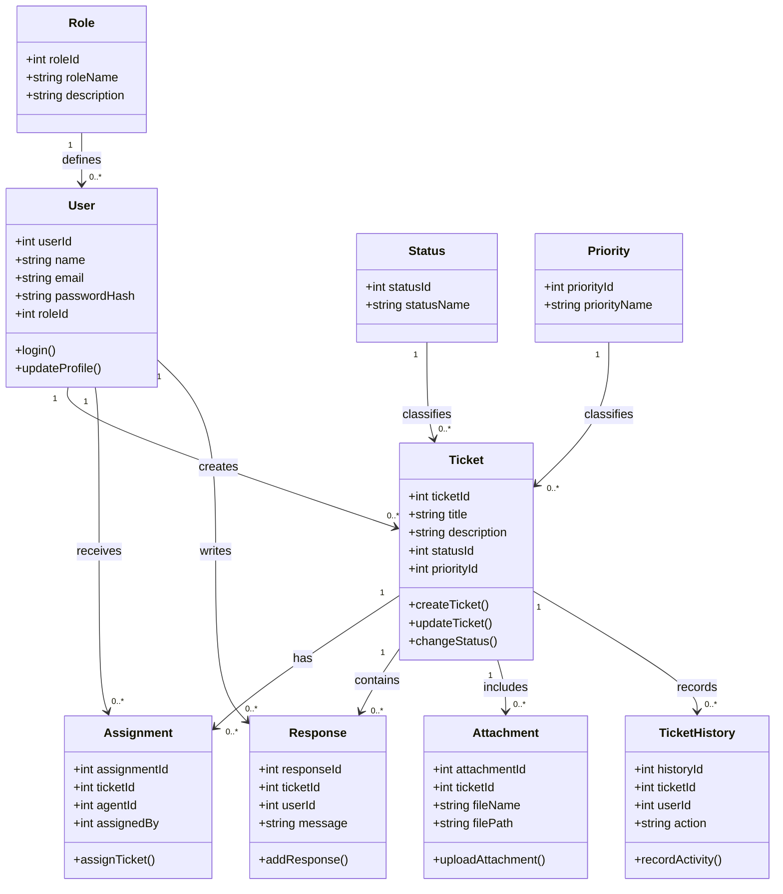
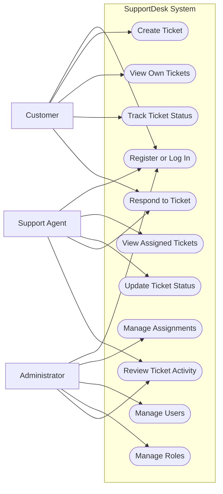
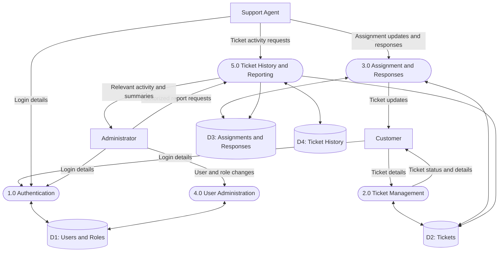
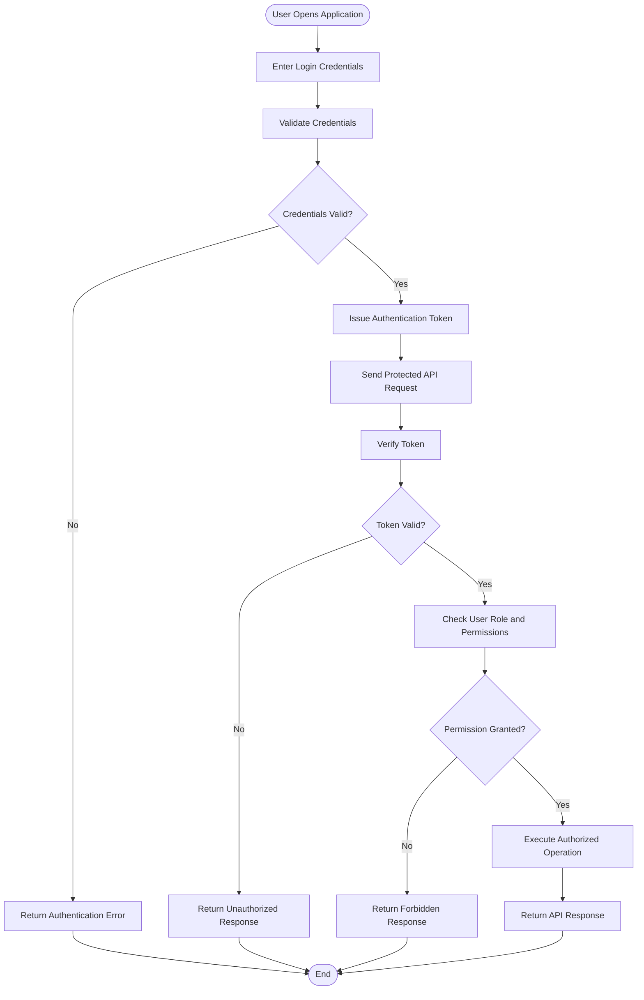

# 🎫 SupportDesk — Customer Support Ticket Management System

<p align="center">
  <strong>One Platform. Every Ticket. Better Support.</strong>
</p>

<p align="center">
  📌 Project Status: Planning — Pending Senior Review
</p>

<p align="center">
  
  
  
  
</p>

---

## 📑 Table of Contents

- [📖 Project Overview](#-project-overview)
- [🎯 Project Objectives](#-project-objectives)
- [👥 User Roles](#-user-roles)
- [✨ Proposed Features](#-proposed-features)
- [🛠️ Proposed Technology Stack](#-proposed-technology-stack)
- [🏗️ System Architecture](#️-system-architecture)
- [🔄 Ticket Workflow](#-ticket-workflow)
- [📐 System Diagrams](#-system-diagrams)
  - [Entity Relationship Diagram](#1-entity-relationship-diagram)
  - [Class Diagram](#2-class-diagram)
  - [Use Case Diagram](#3-use-case-diagram)
  - [Data Flow Diagram](#4-data-flow-diagram)
  - [Authentication and Authorization Flow](#5-authentication-and-authorization-flow)
- [🗄️ Proposed Database Design](#️-proposed-database-design)
- [🔌 Proposed API Modules](#-proposed-api-modules)
- [🔐 Security and Privacy](#-security-and-privacy)
- [🧪 Testing Strategy](#-testing-strategy)
- [📁 Proposed Repository Structure](#-proposed-repository-structure)
- [🚀 Getting Started](#-getting-started)
- [📅 Proposed Development Roadmap](#-proposed-development-roadmap)
- [❓ Open Questions](#-open-questions)
- [🤝 Contribution Guidelines](#-contribution-guidelines)

---

## 📖 Project Overview

**SupportDesk** is a proposed customer support ticket management system designed to organize, track, and manage customer issues through a centralized platform.

In many organizations, customer queries and technical issues are handled through scattered emails, messages, and manual processes. This can make it difficult to track progress, assign responsibility, maintain communication, and resolve issues efficiently.

SupportDesk aims to provide a structured workflow where customers can submit support tickets, support agents can manage and resolve them, and administrators can oversee users and system operations.

The project is currently in the planning phase. The requirements, technology stack, database design, and diagrams in this README are proposals pending review.

## 🎯 Project Objectives

- Centralize customer support requests in one platform.
- Allow customers to create and track support tickets.
- Enable support agents to manage assigned tickets.
- Organize tickets by status and priority.
- Maintain a history of ticket updates and responses.
- Provide role-based access to authorized features.
- Improve communication and visibility throughout the support process.
- Establish a maintainable foundation for future enhancements.

## 👥 User Roles

### 👤 1. Customer

Customers will be able to:

- Register and log in.
- Create new support tickets.
- Describe issues and provide relevant details.
- View their own tickets.
- Track ticket status and progress.
- Communicate with support agents.
- View previous ticket activity.

### 🧑‍💻 2. Support Agent

Support agents will be able to:

- View tickets available to them according to permissions.
- Access assigned tickets.
- Review customer issues.
- Update ticket status and priority where authorized.
- Respond to customer queries.
- Record ticket updates.
- Resolve issues and maintain ticket history.

### 🛡️ 3. Administrator

Administrators will be able to:

- Manage user accounts.
- Assign roles and permissions.
- Oversee ticket operations.
- Manage assignments and ticket statuses.
- Review relevant system activity.
- Access administrative functions according to approved requirements.

*Final role permissions and access rules are pending senior review.*

## ✨ Proposed Features

### 🔑 Authentication and User Management

- User registration and login.
- Secure password handling.
- Authentication and authorization.
- Role-based access control.
- User profile management.

### 🎫 Ticket Management

- Create, view, and update support tickets.
- Assign tickets to support agents.
- Set ticket priorities.
- Track ticket statuses.
- View ticket details and history.
- Close or reopen tickets according to approved workflow rules.

### 💬 Communication

- Customer and agent responses.
- Conversation history associated with tickets.
- Optional internal notes for agents, subject to approval.
- Optional file attachments for supporting evidence.

### 📊 Administration and Reporting

- User and role management.
- Ticket overview and filtering.
- Ticket status and priority summaries.
- Basic operational reports, if included in the approved MVP scope.

## 🛠️ Proposed Technology Stack

The following stack is proposed and has not yet been confirmed as the final implementation stack.

### Frontend

- **React** — component-based user interface.
- **Vite** — frontend development and build tooling.
- **Tailwind CSS** — utility-first styling.
- **React Router** — client-side navigation, if selected.

### Backend

- **Node.js** — JavaScript runtime.
- **Express.js** — backend API framework.
- **JWT** — proposed token-based authentication mechanism.
- **Validation middleware** — request validation and input checks.

### Database

- **PostgreSQL** — relational database for users, tickets, assignments, responses, and related records.

### Development and Testing

- Git and GitHub for version control.
- Postman for API testing.
- Jest or an equivalent testing framework, subject to selection.
- Playwright or an equivalent tool for end-to-end testing, subject to selection.

## 🏗️ System Architecture

The proposed architecture separates the frontend, backend API, and database.



**Architecture explanation:**

- The frontend provides the user interface.
- The backend exposes APIs for application operations.
- Authentication and authorization protect restricted resources.
- Application services implement ticket and user management logic.
- PostgreSQL stores persistent application data.

This architecture is a proposed design, not a claim that these components have already been implemented.

## 🔄 Ticket Workflow

The proposed ticket lifecycle describes how a support request could move from creation to resolution.



**Workflow explanation:**

1. A customer logs in and creates a support ticket.
2. The system validates the submitted information.
3. The ticket becomes available for review and assignment.
4. An authorized agent investigates the reported issue.
5. The agent communicates updates to the customer.
6. If the issue remains unresolved, investigation continues.
7. Once resolved, the ticket is moved to the appropriate final status.

The exact status transitions and reopening rules must be finalized during requirements review.

## 📐 System Diagrams

The following diagrams are individual Mermaid blocks. GitHub supports Mermaid diagrams inside Markdown files when the code fence is written as `mermaid`.

### 1. Entity Relationship Diagram

This proposed ER diagram shows the main entities and their relationships.



**ER diagram explanation:**

- `ROLE` defines the role assigned to a user.
- `USER` stores user account information.
- `TICKET` stores support requests.
- `STATUS` and `PRIORITY` classify tickets.
- `ASSIGNMENT` records ticket assignments.
- `RESPONSE` stores ticket communication.
- `ATTACHMENT` records files associated with tickets.
- `TICKET_HISTORY` records relevant ticket activity.

The exact cardinalities, constraints, and ownership rules need to be confirmed before database implementation. For example, the final design should define whether a ticket can have multiple historical assignments and whether attachments can belong to individual responses.

### 2. Class Diagram

This proposed class diagram represents the main application models and their associations.



**Class diagram explanation:**

- Each class represents a proposed application entity.
- Attributes describe the information associated with each entity.
- Operations describe example responsibilities.
- Associations represent relationships between application entities.

The diagram is conceptual. Final methods, service classes, and implementation details should be determined during backend design.

### 3. Use Case Diagram

Mermaid does not provide a native UML use-case diagram syntax. The following flowchart presents the main actors and their proposed interactions with SupportDesk.



**Use case explanation:**

- Customers create tickets and track their own support requests.
- Support agents review assigned tickets, respond, and update progress.
- Administrators manage users, roles, assignments, and authorized oversight functions.

The available use cases depend on the final role-based access control requirements.

### 4. Data Flow Diagram

This proposed high-level DFD shows how information moves between users, application processes, and the database.



**DFD explanation:**

- Authentication validates user access.
- Ticket management processes customer support requests.
- Assignment and response processes manage agent work and communication.
- User administration handles user and role operations.
- History and reporting processes retrieve relevant activity information.

This is a high-level conceptual data flow diagram. Detailed data stores, external services, and process boundaries may change during implementation planning.

### 5. Authentication and Authorization Flow

This diagram shows a proposed request authentication process.



**Security flow explanation:**

- Users submit credentials for authentication.
- Valid credentials result in an authenticated session or token.
- Protected requests are checked before processing.
- The backend verifies identity and permissions.
- Unauthorized requests are rejected.
- Authorized requests continue to the relevant application operation.

Token storage, expiration, refresh behavior, and logout handling must be finalized in the security design.

## 🗄️ Proposed Database Design

The following entities are proposed for the initial relational database.

### ROLE

Stores available application roles.

- `role_id` — primary key.
- `role_name` — role name.
- `description` — optional role description.

### USER

Stores user account details.

- `user_id` — primary key.
- `role_id` — foreign key to ROLE.
- `name` — user's display name.
- `email` — user's email address.
- `password_hash` — securely stored password hash.
- `created_at` — account creation timestamp.

### TICKET

Stores customer support requests.

- `ticket_id` — primary key.
- `customer_id` — foreign key to USER.
- `status_id` — foreign key to STATUS.
- `priority_id` — foreign key to PRIORITY.
- `title` — ticket subject.
- `description` — issue description.
- `created_at` — creation timestamp.
- `updated_at` — last update timestamp.

### STATUS

Defines the available ticket statuses.

- `status_id` — primary key.
- `status_name` — status label.

### PRIORITY

Defines the available ticket priority levels.

- `priority_id` — primary key.
- `priority_name` — priority label.

### ASSIGNMENT

Records ticket assignment information.

- `assignment_id` — primary key.
- `ticket_id` — foreign key to TICKET.
- `agent_id` — foreign key to USER.
- `assigned_by` — user who made the assignment.
- `assigned_at` — assignment timestamp.

### RESPONSE

Stores customer and agent responses.

- `response_id` — primary key.
- `ticket_id` — foreign key to TICKET.
- `user_id` — foreign key to USER.
- `message` — response content.
- `created_at` — response timestamp.

### ATTACHMENT

Stores metadata for files associated with tickets.

- `attachment_id` — primary key.
- `ticket_id` — foreign key to TICKET.
- `file_name` — original or display filename.
- `file_path` — storage reference.
- `uploaded_at` — upload timestamp.

### TICKET_HISTORY

Records ticket activity.

- `history_id` — primary key.
- `ticket_id` — foreign key to TICKET.
- `user_id` — foreign key to USER.
- `action` — activity description.
- `created_at` — activity timestamp.

The schema, naming conventions, constraints, indexing, and deletion policies require review before SQL migrations are created.

## 🔌 Proposed API Modules

The backend may be organized into the following API modules.

### Authentication

- Register a user.
- Log in.
- Log out or invalidate a session, depending on the authentication design.
- Retrieve the current user's profile.

### Users and Roles

- Retrieve permitted user information.
- Update user details.
- Manage user accounts.
- Manage roles and permissions, for authorized administrators.

### Tickets

- Create a ticket.
- Retrieve ticket details.
- List tickets according to access permissions.
- Update ticket information.
- Change ticket status or priority.

### Assignments

- Assign a ticket to an agent.
- Change an assignment.
- Retrieve assignment information.

### Responses and Attachments

- Add a response to a ticket.
- Retrieve ticket responses.
- Upload and retrieve permitted attachments.

### History and Reports

- Retrieve authorized ticket history.
- Generate approved ticket summaries.
- Filter tickets by relevant attributes.

Actual endpoint paths, HTTP methods, request schemas, response formats, and error codes should be documented in the API specification.

## 🔐 Security and Privacy

Security should be considered throughout development.

- Hash passwords using a suitable password-hashing algorithm.
- Validate all incoming request data.
- Enforce role-based access control on the backend.
- Verify ticket ownership before returning customer-specific information.
- Restrict administrative operations to authorized users.
- Store secrets in environment variables rather than source code.
- Apply appropriate file-upload restrictions if attachments are implemented.
- Avoid exposing passwords, tokens, and sensitive information in logs.
- Use secure transport and appropriate security headers in deployment.
- Record relevant security and ticket activity without unnecessarily collecting personal information.

## 🧪 Testing Strategy

### Unit Testing

Test individual functions and business rules, including:

- Input validation.
- Ticket status transitions.
- Assignment rules.
- Permission checks.
- Service-layer operations.

### API Testing

Test the backend endpoints for:

- Successful requests.
- Invalid request data.
- Missing or invalid authentication.
- Insufficient permissions.
- Missing resources.
- Unexpected server errors.

### Integration Testing

Verify that the application correctly connects:

- Authentication and user management.
- Ticket services and PostgreSQL.
- Assignments and ticket records.
- Responses and ticket history.

### End-to-End Testing

Test complete user journeys, such as:

- Customer creates a ticket.
- Agent views and updates an assigned ticket.
- Customer checks ticket progress.
- Administrator manages a user account.

Testing tools should be finalized after the development stack and repository structure are approved.

## 📁 Proposed Repository Structure

The following directory structure is a starting proposal, not an existing implementation guarantee.

```text
SupportDesk/
├── README.md
├── .gitignore
├── .editorconfig
├── .env.example
│
├── docs/
│   ├── PRD/
│   │   └── SupportDesk-PRD.docx
│   ├── diagrams/
│   │   ├── er-diagram.png
│   │   ├── class-diagram.png
│   │   ├── use-case-diagram.png
│   │   └── data-flow-diagram.png
│   ├── api/
│   │   └── API-Specification.md
│   ├── database/
│   │   └── schema.sql
│   ├── testing/
│   │   └── test-plan.md
│   └── decisions/
│       └── architecture-decisions.md
│
├── frontend/
│   ├── public/
│   ├── src/
│   │   ├── components/
│   │   ├── layouts/
│   │   ├── pages/
│   │   ├── features/
│   │   │   ├── auth/
│   │   │   ├── tickets/
│   │   │   ├── responses/
│   │   │   ├── attachments/
│   │   │   ├── users/
│   │   │   └── reports/
│   │   ├── hooks/
│   │   ├── services/
│   │   ├── utils/
│   │   ├── styles/
│   │   ├── App.jsx
│   │   └── main.jsx
│   └── package.json
│
├── backend/
│   ├── src/
│   │   ├── config/
│   │   ├── middleware/
│   │   ├── modules/
│   │   │   ├── auth/
│   │   │   ├── users/
│   │   │   ├── roles/
│   │   │   ├── tickets/
│   │   │   ├── assignments/
│   │   │   ├── responses/
│   │   │   ├── attachments/
│   │   │   ├── history/
│   │   │   └── reports/
│   │   ├── routes/
│   │   ├── validators/
│   │   ├── utils/
│   │   ├── app.js
│   │   └── server.js
│   ├── tests/
│   └── package.json
│
├── database/
│   ├── migrations/
│   └── seeds/
│
├── tests/
│   └── e2e/
│
└── .github/
    ├── ISSUE_TEMPLATE/
    └── pull_request_template.md
```

The final structure may be simplified or expanded based on the approved project scope and development conventions.

## 🚀 Getting Started

**Prerequisites for the proposed stack:**

- Node.js and npm.
- PostgreSQL.
- Git.
- A code editor.
- Postman or another API client for testing.

### 1. Clone the Repository

```bash
git clone <repository-url>
cd SupportDesk
```

Replace `<repository-url>` with the actual repository URL.

### 2. Configure the Backend

```bash
cd backend
npm install
```

Configure the required environment variables using the project's approved configuration.

Example `.env.example`:

```dotenv
PORT=5000
DATABASE_URL=
JWT_SECRET=
NODE_ENV=development
```

Use appropriate local development values in your private `.env` file. Never commit actual credentials or secrets.

### 3. Configure the Frontend

```bash
cd ../frontend
npm install
```

### 4. Start Development Servers

The exact scripts depend on the `package.json` files created during implementation.

Typical commands, once the corresponding scripts exist, may be:

```bash
# Backend
cd backend
npm run dev
```

```bash
# Frontend — in a separate terminal
cd frontend
npm run dev
```

These are setup examples; they will work only after the project files, scripts, database configuration, and required dependencies have been created.

## 📅 Proposed Development Roadmap

### Phase 1 — Requirements and Planning

- Review the PRD with the project senior.
- Confirm the MVP features.
- Finalize user roles and permissions.
- Review system diagrams and database relationships.
- Confirm the technology stack.

### Phase 2 — Database and Backend Foundation

- Create the database schema.
- Set up the Express application.
- Configure database connectivity.
- Implement authentication and authorization.
- Establish validation and error-handling conventions.

### Phase 3 — Core Ticket Management

- Implement ticket creation and retrieval.
- Implement assignment workflows.
- Implement status and priority updates.
- Implement responses and ticket history.
- Add attachment support if approved.

### Phase 4 — Frontend Development

- Create the application layout.
- Build login and registration screens.
- Build customer ticket pages.
- Build agent ticket management pages.
- Build administrator pages.
- Connect frontend components to backend APIs.

### Phase 5 — Testing and Review

- Perform unit and API testing.
- Test role-based permissions.
- Validate ticket lifecycle behavior.
- Fix identified defects.
- Review documentation and deployment readiness.

## ❓ Open Questions

The following decisions need to be confirmed before implementation:

- Which features are mandatory for the MVP?
- Can support agents view all tickets or only assigned tickets?
- Can customers reopen resolved tickets?
- Which ticket statuses and transitions are permitted?
- Are internal notes required?
- Are file attachments included in the first release?
- Which reports are required?
- How should ticket assignment and reassignment work?
- Which authentication and token-management approach will be used?
- Where will uploaded files be stored?
- Which deployment environment will be used?

## 🤝 Contribution Guidelines

Before contributing:

1. Review the approved requirements and architecture.
2. Create a branch for the change.
3. Follow the established naming and coding conventions.
4. Validate inputs and enforce permissions.
5. Add or update relevant tests.
6. Update documentation when behavior changes.
7. Submit a pull request describing the change and its verification.

## 📌 Project Status

**Current stage: Planning — Pending Senior Review**

SupportDesk is being prepared as a structured customer support ticket management system. This README documents the proposed architecture, data model, workflow, and development plan.

The diagrams are conceptual design references. They should be reviewed and approved before being treated as final implementation specifications.

---

<p align="center">
  🎫 <strong>SupportDesk</strong>
  <br/>
  <em>Organize Requests. Track Progress. Improve Support.</em>
</p>
