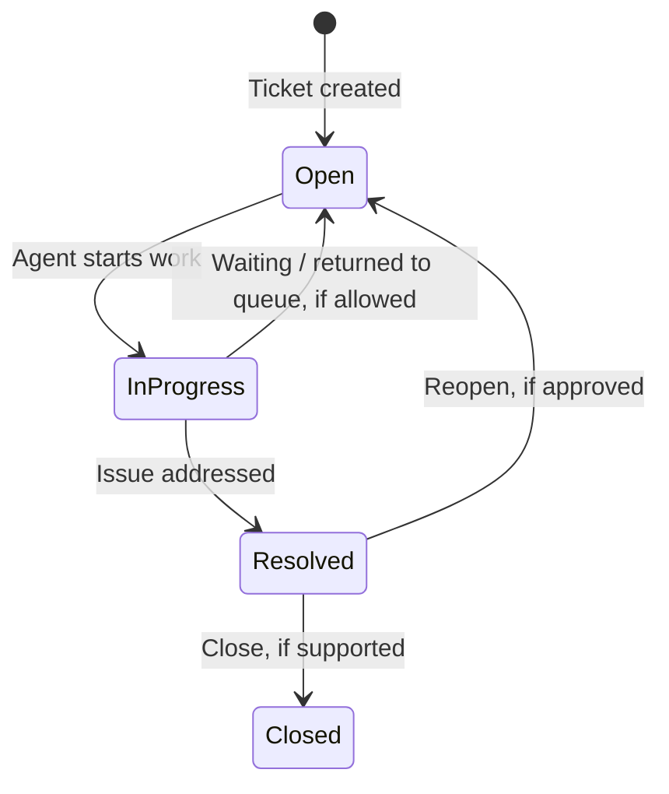
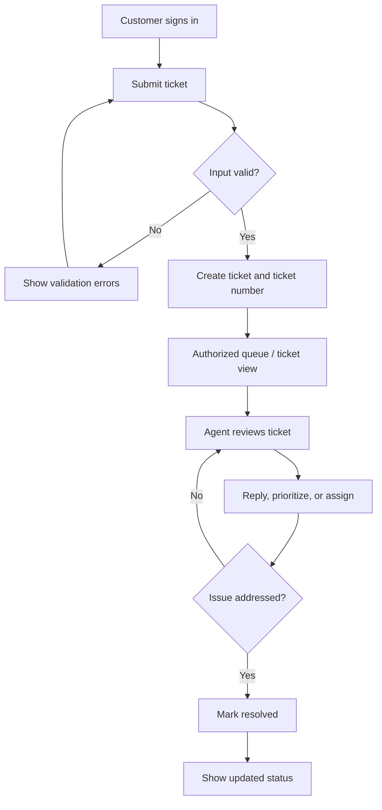
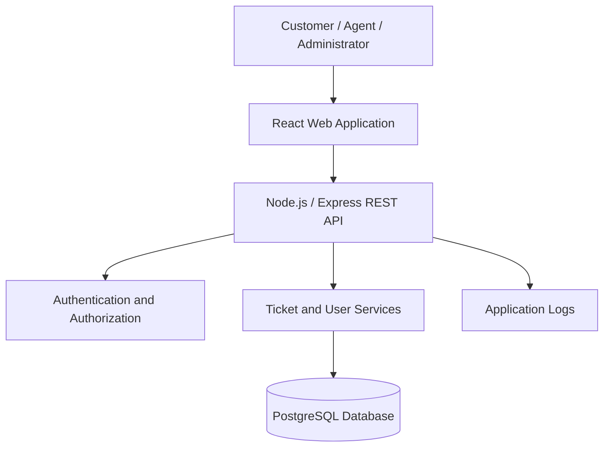

# 🎫 SupportDesk_PRD

## Customer Support Ticket Management System

*A clear, centralized workflow for raising, managing, and resolving support requests.*

| 📄 Document | 🏷️ Version | 🚦 Status | 🗓️ Updated |
|---|---|---|---|
| Project README + Product Requirements Overview | 1.4 | 🟡 Draft for review | 22 October 2026 |

> **Note:** Requirements, priorities, technical choices, and timelines marked *proposed* must be reviewed by the project senior.

SupportDesk is a proposed web-based application for managing customer support requests in one central place. Customers can raise and track tickets, support agents can respond to, prioritize, assign, and resolve them, and administrators can manage access and monitor ticket activity.

This README brings together the current project overview, proposed requirements, user stories, workflow, architecture, data model, API outline, quality expectations, and delivery plan. Any detail marked **Proposed**, **Optional**, or **To confirm** must be reviewed with the project senior before implementation.

### ✨ At a glance

| Area | Summary |
|---|---|
| Product | Customer support ticket management |
| Main users | Customers, support agents, administrators |
| Proposed frontend | React + Vite + Tailwind CSS |
| Proposed backend | Node.js + Express.js |
| Proposed database | PostgreSQL |
| First milestone | Reliable core ticket workflow |
| Later possibilities | AI assistance, automation, integrations, mobile app |

> **Project principle:** Build and test the core ticket workflow first. Add optional enhancements only after the senior confirms the scope.

---

## 🗂️ Contents

**Project basics**
1. Project Overview
2. Problem Statement
3. Objectives
4. Project Scope

**Users and product behavior**
5. Users and Roles
6. Main Features
7. Ticket Lifecycle
8. User Stories and Acceptance Criteria

**Requirements and design**
9. Functional Requirements
10. Non-Functional Requirements
11. Proposed Technology Stack
12. High-Level Architecture
13. Proposed Data Model
14. Proposed REST API

**Delivery and governance**
15. Security and Privacy
16. Testing and Acceptance
17. Eight-Week Delivery Roadmap
18. Repository Structure
19. Local Setup
20. Risks and Mitigations
21. Assumptions and Open Questions
22. Glossary
23. Approval Checklist
24. Document History
---

### 👀 How to read this document

- **Proposed** means a working recommendation that still needs senior review.
- **MVP** means the first release focused on the essential ticket workflow.
- **Acceptance criteria** describe testable outcomes for a user story.
- **Open questions** are decisions to confirm before implementation.

---

## 1. Project Overview

> **One workspace. Clear ownership. Trackable resolutions.**

SupportDesk is intended to provide a structured workflow for customer support requests. Each request is represented by a ticket with a unique identifier, details, status, priority, customer, optional assignee, replies, and relevant history.

### Product vision

Make support requests easier to submit, track, assign, communicate about, and resolve through a centralized, secure, and maintainable system.

### Project context

The current project direction is to build and validate the core ticket-management application first. Potential later capabilities include AI-assisted support, workflow automation, mobile applications, and AI agents. These are **future possibilities**, not commitments for the first release. AI features should not be added until the core workflow, persistent storage, API, tests, and acceptance checks are working successfully.

## 2. Problem Statement

Support requests handled through disconnected messages, spreadsheets, or informal processes can be hard to track. Teams may lack a consistent view of ticket ownership, urgency, progress, and communication history.

SupportDesk proposes to address this by:
- Providing a central place to create and view tickets.
- Keeping ticket status and communication associated with the request.
- Giving authorized agents tools to prioritize, assign, respond to, and resolve tickets.
- Giving administrators user-access controls and basic operational visibility.
- Enforcing server-side authorization so ticket data is not exposed to unauthorized users.

These are proposed product needs and should be confirmed against the project senior's expectations.

## 3. Objectives

### Primary objectives
1. Let customers submit support requests.
2. Give customers an appropriate way to view their own ticket details and status.
3. Let support agents handle tickets through a consistent workflow.
4. Make ticket ownership, priority, status, and replies visible to authorized users.
5. Let administrators manage user accounts and roles.
6. Provide basic reporting or summary metrics if confirmed in MVP scope.
7. Build a testable web application with a persistent relational database.

### Candidate success measures
- Valid ticket submissions create a ticket and return a unique identifier.
- Users cannot view or modify tickets beyond their permissions.
- Authorized users can add replies and perform allowed status transitions.
- Invalid input produces clear validation feedback.
- Critical workflows pass approved acceptance tests.
- The application can be run and reviewed in a documented environment.

Numeric performance, availability, and service-level targets are **to confirm**.

## 4. Project Scope

### 4.1 MVP at a glance

The first version is intended to answer three questions well: **Who needs help? What is happening with the ticket? Who is responsible for the next action?**

### 4.1.1 Proposed MVP — core workflow

- Authentication for protected functionality.
- Role-based access control for customer, support agent, and administrator roles.
- Create a support ticket.
- List and view tickets according to permissions.
- View ticket details, status, priority, and conversation.
- Add replies to tickets.
- Set ticket priority.
- Assign tickets to agents, if approved.
- Update ticket status and resolve tickets.
- Manage users and role assignments as an administrator.
- Basic ticket summary/report view, if approved.
- Input validation, error handling, and automated tests.

### 4.2 Potential future enhancements — not part of the confirmed MVP

- AI-assisted ticket classification or suggested priority.
- AI-generated response suggestions.
- AI support agents or conversational assistance.
- Workflow automation and configurable rules.
- Mobile application.
- Email or SMS notifications.
- Attachments.
- Third-party CRM or service integrations.
- Advanced analytics and custom reports.
- Multi-organization tenancy.

Future features should be planned only after core workflows are stable and approved.

### 4.3 Out of scope unless specifically approved

- Billing and payment processing.
- A native mobile app in the initial release.
- Autonomous AI actions that change ticket state without human oversight.
- Integrations not requested by the project senior.

## 5. Users and Roles

| Role | Main needs | Proposed permissions |
|---|---|---|
| **Customer** | Raise support requests and track progress | Create tickets; view own tickets; reply where allowed |
| **Support Agent** | Work on incoming requests | View authorized tickets; reply; update status/priority; assign tickets if permitted |
| **Administrator** | Manage access and monitor the system | Manage users and roles; view administrative information and approved reports |

### Access-control principles
- Enforce permissions on the backend for every protected operation.
- Do not rely only on hiding buttons in the frontend.
- Customers should not be able to access another customer's ticket unless a specific approved rule allows it.
- Exact agent visibility and administrator powers must be confirmed.

## 6. Main Features

The MVP should focus on the essentials first: secure access, a reliable ticket lifecycle, and clear communication. Optional enhancements should wait until this workflow is tested.

| Feature | Description | Status |
|---|---|---|
| Authentication | Sign in and protect private areas | Proposed MVP |
| Ticket creation | Submit subject, description, and required fields | Proposed MVP |
| Ticket list and details | View authorized tickets and their details | Proposed MVP |
| Replies | Keep customer-agent messages with the ticket | Proposed MVP |
| Priority management | Mark tickets with an approved priority level | Proposed MVP |
| Assignment | Set a responsible agent | Proposed; confirm permissions |
| Status management | Move tickets through an agreed lifecycle | Proposed MVP |
| User administration | Manage accounts and roles | Proposed MVP |
| Reports | Show approved ticket summaries | Proposed; confirm scope |
| AI assistance | Classification or response suggestions | Future phase only |
| Automation | Rules for repetitive workflow steps | Future phase |
| Mobile experience | Mobile-responsive web UI first; native app later if needed | Native app is future scope |

## 7. Ticket Lifecycle

### Proposed states

- **Open** — ticket has been created and is awaiting handling.
- **In Progress** — an agent is actively handling the request.
- **Resolved** — the request has been marked as addressed.
- **Closed** — optional final state, only if approved.

The exact statuses, valid transitions, and reopening behavior must be agreed before implementation.



### Proposed end-to-end workflow



## 8. User Stories and Acceptance Criteria

The eight stories below reflect the current working plan. Review them with the senior before treating them as approved requirements.

### US-01 — Submit a support ticket
**As a customer, I want to submit a support ticket so that I can request help.**

- **AC-01:** Given I am authenticated and have entered valid required details, when I submit the form, then the system creates a ticket and displays its unique identifier.
- **AC-02:** Given a required field is missing or invalid, when I submit the form, then validation feedback is shown and no ticket is created.

### US-02 — View ticket details
**As an authorized user, I want to view ticket details so that I can understand the status and history.**

- **AC-01:** Given I have permission to access a ticket, when I open it, then its subject, description, status, priority, and available conversation history are shown.
- **AC-02:** Given I do not have permission, when I request the ticket, then access is denied without exposing protected data.

### US-03 — Respond to a ticket
**As an authorized participant, I want to reply to a ticket so that communication stays in one place.**

- **AC-01:** Given I can access an active ticket and have entered a valid reply, when I submit it, then the reply is saved and displayed in the conversation.
- **AC-02:** Given the reply is empty or replies are not allowed for the ticket's current state, when I submit it, then the system rejects it and explains the issue.

### US-04 — Prioritize tickets
**As a support agent, I want to set ticket priority so that urgent requests can be handled appropriately.**

- **AC-01:** Given I am authorized to change priority, when I select a permitted value and save, then the updated priority is displayed.
- **AC-02:** Given I lack permission or submit an unsupported value, when I attempt the update, then the system rejects the change.

### US-05 — Resolve a ticket
**As a support agent, I want to resolve a ticket so that completed requests are marked accordingly.**

- **AC-01:** Given I am authorized and the ticket is eligible for resolution, when I mark it resolved, then the system saves and displays the resolved status.
- **AC-02:** Given the ticket cannot be resolved under configured rules, when I attempt resolution, then the system rejects the transition and explains why.

### US-06 — Assign support tickets
**As an authorized user, I want to assign a ticket to an agent so that ownership is clear.**

- **AC-01:** Given I have assignment permission and the selected agent is eligible, when I assign the ticket, then the new assignee is saved and displayed.
- **AC-02:** Given I lack permission or the selected agent is invalid/inactive, when I submit the assignment, then the system rejects it.

### US-07 — Manage system access
**As an administrator, I want to manage user accounts and roles so that access is controlled.**

- **AC-01:** Given I am an administrator, when I create or update a valid user and role assignment, then the system saves the change and confirms the result.
- **AC-02:** Given I am not an administrator, when I attempt an administrative action, then the system denies the action.

### US-08 — Monitor reports
**As an authorized user, I want to view basic ticket reports so that I can understand workload.**

- **AC-01:** Given I have reporting permission, when I open reports, then the system displays the agreed ticket summary metrics for the selected period.
- **AC-02:** Given I lack reporting permission or use an invalid filter, when I request a report, then access is denied or validation feedback is returned.

**To confirm:** report metrics, ticket fields, categories, allowed priorities, status transitions, reopening rules, and exact permissions.

## 9. Functional Requirements

Priorities are provisional and must be confirmed.

| ID | Requirement | Priority |
|---|---|---|
| FR-01 | Authenticate users before granting access to protected functionality. | Critical |
| FR-02 | Enforce role-based permissions and ticket access rules on the server. | Critical |
| FR-03 | Allow customers to create tickets with required fields. | Critical |
| FR-04 | Generate a unique identifier for each ticket. | Critical |
| FR-05 | Allow authorized users to view ticket details and status. | High |
| FR-06 | Allow authorized participants to add ticket replies. | Critical |
| FR-07 | Allow authorized agents to set ticket priority. | High |
| FR-08 | Allow authorized users to assign tickets to agents. | Medium |
| FR-09 | Allow authorized agents to update status and resolve tickets. | High |
| FR-10 | Allow administrators to manage user accounts and roles. | Critical |
| FR-11 | Provide basic ticket summaries to authorized users if reports are approved. | Low |
| FR-12 | Validate input and return understandable error responses. | High |
| FR-13 | Preserve ticket replies and relevant status/assignment history according to agreed data rules. | High |
| FR-14 | Prevent unauthorized users from reading or modifying protected tickets. | Critical |

## 10. Non-Functional Requirements

Numeric targets should be agreed before performance or availability can be tested.

| ID | Category | Proposed requirement |
|---|---|---|
| NFR-01 | Security | Protected endpoints require authentication and server-side authorization. |
| NFR-02 | Privacy | Users only receive data permitted by role and ticket access rules. |
| NFR-03 | Reliability | Failures return controlled errors and do not leave partial updates. |
| NFR-04 | Usability | Forms label required fields and show clear validation messages. |
| NFR-05 | Performance | Common operations meet a target agreed with the senior. |
| NFR-06 | Maintainability | Backend code separates routing, business logic, and data access. |
| NFR-07 | Compatibility | The UI works in the desktop browsers agreed by the team. |
| NFR-08 | Testability | Core business rules and access control have automated test coverage. |
| NFR-09 | Accessibility | Navigation and forms support keyboard use and readable labels where feasible. |
| NFR-10 | Observability | Errors are logged without unnecessarily exposing secrets or sensitive content. |
| NFR-11 | Data integrity | Relationships and required fields are enforced by application and database rules. |

## 11. Proposed Technology Stack

The current proposal uses a relational database. **PostgreSQL is proposed; MongoDB is not part of this stack proposal.** These choices still need senior confirmation.

| Layer | Proposed technology | Intended use |
|---|---|---|
| Frontend | React + Vite | Web interface |
| Styling | Tailwind CSS | Responsive UI styling |
| Backend | Node.js + Express.js | REST API and business logic |
| Database | PostgreSQL | Relational storage for users, tickets, replies, and history |
| Authentication | Secure session or token-based approach, to be selected | Sign-in and protected access |
| Testing | Unit and API/integration tests | Verify rules and workflows |
| Version control | Git | Source history and collaboration |

**Approval needed:** confirm the stack, authentication approach, testing libraries, hosting, and coding standards with the senior.

## 12. High-Level Architecture



### Architecture responsibilities

- **Frontend:** pages, forms, ticket lists, ticket details, validation feedback, and role-aware navigation.
- **Backend API:** request validation, authentication, authorization, business rules, and consistent responses.
- **Services:** ticket creation, replies, priority, assignment, status transitions, user administration, and reporting logic.
- **Database:** persistent relational data and constraints.
- **Logging:** useful diagnostics without logging secrets or unnecessary private content.

## 13. Proposed Data Model

These are conceptual entities, not a finalized database schema.

| Entity | Example fields | Purpose |
|---|---|---|
| User | id, name, email, password_hash, role, active, created_at | Account and access information |
| Ticket | id, ticket_number, subject, description, status, priority, customer_id, assignee_id, created_at, updated_at | Support request |
| TicketReply | id, ticket_id, author_id, message, created_at | Conversation messages |
| TicketHistory | id, ticket_id, actor_id, action, old_value, new_value, created_at | Audit/history of important changes |

### Data design considerations
- Use stable primary keys and foreign keys.
- Store password hashes, never plaintext passwords.
- Enforce uniqueness for user email and ticket number where appropriate.
- Index fields used frequently for filtering, such as status, priority, assignee, and creation date, after reviewing query needs.
- Define deletion, account deactivation, retention, and audit policies.
- Decide whether ticket replies can be edited or deleted and who can do so.

## 14. Proposed REST API

Routes are a starting point, not an approved API contract. Request/response schemas, pagination, filtering, and error formats need technical design.

| Method | Route | Purpose |
|---|---|---|
| POST | `/api/auth/register` | Register a user, if public registration is allowed |
| POST | `/api/auth/login` | Authenticate a user |
| GET | `/api/tickets` | List tickets visible to the current user |
| POST | `/api/tickets` | Create a ticket |
| GET | `/api/tickets/:id` | Retrieve an authorized ticket |
| PATCH | `/api/tickets/:id` | Update permitted ticket fields |
| GET | `/api/tickets/:id/replies` | List ticket replies |
| POST | `/api/tickets/:id/replies` | Add a reply |
| PATCH | `/api/tickets/:id/assignment` | Assign a ticket |
| PATCH | `/api/tickets/:id/status` | Change ticket status |
| GET | `/api/reports/tickets` | Retrieve agreed ticket summaries |
| GET | `/api/admin/users` | List users, for authorized administrators |
| POST | `/api/admin/users` | Create a user, if permitted |
| PATCH | `/api/admin/users/:id` | Update account/role details, if permitted |

### API behavior expectations
- Validate every request on the server.
- Return suitable HTTP status codes and a consistent error structure.
- Enforce authorization for both reading and changing records.
- Do not expose password hashes, tokens, or unnecessary internal data in responses.
- Document filters, pagination, and sorting before implementation.

## 15. Security and Privacy

- Hash passwords using a maintained password-hashing library.
- Validate and normalize client-supplied data on the server.
- Enforce authentication and authorization on every protected operation.
- Check ticket visibility before returning ticket details or replies.
- Use parameterized database queries or a safe ORM.
- Store secrets in environment variables or an approved secrets manager; never commit them.
- Configure CORS and HTTPS appropriately for the deployment environment.
- Avoid logging passwords, tokens, or unnecessary sensitive message content.
- Define account deactivation, retention, backup, and deletion behavior before production.
- Test for privilege escalation and insecure direct object reference risks.

## 16. Testing and Acceptance

### Testing levels
- **Unit tests:** validation, status transitions, priority rules, and permission logic.
- **API/integration tests:** authentication, ticket creation, replies, assignment, status changes, and database behavior.
- **Authorization tests:** customers cannot access other customers' tickets; non-admins cannot perform admin actions.
- **UI tests:** forms, validation messages, ticket list/detail pages, and responsive layout.
- **Regression tests:** rerun core tests after changes.
- **User Acceptance Testing (UAT):** senior or designated reviewer checks the system against approved acceptance criteria.

### Proposed release quality gate
- Critical workflow tests pass.
- Access-control checks pass.
- Known defects and limitations are documented.
- Configuration and database migration steps are reviewed.
- Reviewer approves the release candidate.

### Core acceptance scenarios
1. A valid customer can create a ticket.
2. Invalid ticket data is rejected with clear feedback.
3. An authorized user can view a ticket.
4. An unauthorized user cannot view or modify the ticket.
5. A valid reply is saved and associated with the correct ticket and author.
6. Authorized status, priority, and assignment changes are saved.
7. Admin-only operations are blocked for non-admin users.
8. Approved report metrics are shown only to permitted users.

## 17. Eight-Week Delivery Roadmap

This is a **suggested plan**, not a confirmed schedule. Adjust it to the senior's instructions and project deadlines.

| Week | Focus | Expected deliverable |
|---|---|---|
| 1 | Project understanding, PRD, user stories, acceptance criteria, Kanban setup | Reviewed requirements draft and prioritized backlog |
| 2 | UI flow, data model, API contract, environment setup | Design notes, schema draft, starter project |
| 3 | Authentication and role-based access | Sign-in flow and protected API routes |
| 4 | Ticket creation, listing, and detail view | Core ticket CRUD workflow |
| 5 | Replies, priority, assignment, and status transitions | Agent ticket-handling workflow |
| 6 | User administration and approved basic reports | Admin and reporting functionality |
| 7 | Integration, validation, security checks, and automated tests | Test results and bug fixes |
| 8 | UAT, documentation, deployment preparation, and final review | Reviewed MVP, README, and handover notes |

**Dependency rule:** complete and validate the core ticket workflow before starting AI features or other major enhancements.

## 18. Repository Structure

Suggested layout; adapt to team conventions.

```text
supportdesk/
├── client/
│   ├── public/
│   ├── src/
│   │   ├── components/
│   │   ├── pages/
│   │   ├── layouts/
│   │   ├── services/
│   │   ├── hooks/
│   │   └── routes/
│   └── package.json
├── server/
│   ├── src/
│   │   ├── routes/
│   │   ├── controllers/
│   │   ├── services/
│   │   ├── middleware/
│   │   ├── models/
│   │   ├── validators/
│   │   └── config/
│   └── package.json
├── database/
│   └── migrations/
├── docs/
│   ├── PRD.md
│   └── API.md
├── .gitignore
└── README.md
```

This structure is a proposal. Do not create every directory before implementation needs it.

## 19. Local Setup — When Implementation Exists

The application code and configuration are not described as completed by this document. Once the repository contains the actual implementation, update this section with tested commands.

### Prerequisites (proposed)
- Node.js version agreed by the team.
- npm or the package manager selected by the team.
- PostgreSQL instance.
- Git.

### Setup checklist
1. Clone the project repository.
2. Install frontend and backend dependencies using the repository's package manifests.
3. Create a local PostgreSQL database.
4. Configure environment variables using a documented `.env.example`.
5. Run approved database migrations.
6. Start the backend and frontend using the scripts defined in their `package.json` files.
7. Run automated tests and verify the core ticket workflow.

**Do not add real passwords, tokens, database credentials, or production secrets to the README.** Add exact commands only after verifying them against the actual codebase.

## 20. Risks and Mitigations

| Risk | Potential impact | Proposed mitigation |
|---|---|---|
| Unclear business rules | Rework and inconsistent behavior | Review this document with the senior before implementation |
| Weak access control | Unauthorized ticket exposure or modification | Test permissions at API/service level |
| Scope growth | Delayed delivery | Agree MVP scope and defer optional features |
| Unclear status lifecycle | Incorrect or stuck tickets | Approve status transitions before coding |
| Missing performance targets | No objective performance acceptance test | Define measurable targets with the senior |
| Incomplete test coverage | Regressions and missed edge cases | Map tests to approved acceptance criteria |
| AI added too early | More complexity before core workflows are reliable | Defer AI until core workflow validation is successful |
| Unclear ownership of release | Deployment mistakes | Agree release owner, environment, and rollback steps |

## 21. Assumptions and Open Questions

### Current assumptions
- The project is a web-based support ticket management system.
- Initial roles are customer, support agent, and administrator.
- The first milestone focuses on the core ticket workflow.
- PostgreSQL is preferred; MongoDB is not part of the proposed stack.
- React + Vite and Node.js + Express.js are proposed for the application.
- AI, automation, and mobile applications are later possibilities rather than initial requirements.

### Questions to confirm with the senior
1. Can customers register themselves, or must administrators create accounts?
2. Can agents view every ticket or only assigned tickets?
3. Which ticket statuses are required? Can resolved tickets be reopened?
4. Who can set or change priority?
5. Which fields are mandatory when creating a ticket?
6. Are ticket categories required?
7. Which report metrics are needed for the MVP?
8. Are email notifications or file attachments required?
9. What performance, availability, and browser-support targets apply?
10. Which hosting/deployment environment should be used?
11. Which authentication method, testing tools, and coding standards are required?
12. Are the eight user stories and provisional priorities acceptable?
13. What are the official project milestones and review dates?

## 22. Glossary

| Term | Meaning |
|---|---|
| **PRD** | Product Requirements Document; describes the product problem, goals, scope, requirements, and acceptance expectations. |
| **Epic** | A broad body of work that can be split into smaller stories. |
| **User story** | A short description of a user need, often written as “As a…, I want…, so that…”. |
| **Acceptance criteria** | Testable conditions that define when a story is satisfied. |
| **Task** | A concrete piece of work needed to implement or deliver something. |
| **Kanban** | A workflow board that visualizes work as it moves through columns. |
| **QA** | Quality Assurance; checks whether the product meets defined quality expectations. |
| **UAT** | User Acceptance Testing; a user or stakeholder verifies that the system meets agreed needs. |
| **API** | Application Programming Interface; the contract used by software components to communicate. |
| **RBAC** | Role-Based Access Control; permissions are assigned according to user roles. |
| **MVP** | Minimum Viable Product; the smallest useful product release that meets the agreed core needs. |

## 23. Approval Checklist

Before implementation begins, review and confirm:

- [ ] Problem statement and goals
- [ ] MVP scope and exclusions
- [ ] User roles and permission boundaries
- [ ] Functional requirements and priorities
- [ ] Eight user stories and acceptance criteria
- [ ] Ticket fields, statuses, priorities, and transitions
- [ ] Assignment and ticket-visibility rules
- [ ] Reporting requirements
- [ ] Data model and API contract
- [ ] Technology stack and authentication approach
- [ ] Security, privacy, and testing expectations
- [ ] Eight-week plan or actual delivery schedule
- [ ] Deployment and release approach
- [ ] Open questions resolved or explicitly deferred

## 24. Document History

| Version | Date | Changes |
|---|---|---|
| 1.0 | 22 October 2026 | Initial PRD draft |
| 1.1 | 22 October 2026 | Expanded README with project scope, roles, workflow, requirements, architecture, data model, API outline, quality plan, roadmap, and open questions |
| 1.2 | 22 October 2026 | Changed table of contents to plain text and improved the visual overview |
| 1.3 | 22 October 2026 | Refined heading hierarchy, project metadata, and contents layout |
| 1.4 | 22 October 2026 | Grouped sections, clarified terminology, and improved document structure |

---

## ⚠️ Important Project Note

This document is a self-generated working draft based on the project details currently available. It is **not evidence of senior approval**. Confirm business rules, permissions, priorities, technology decisions, schedule, and future features with the senior. Keep unconfirmed details marked as proposed until reviewed.
