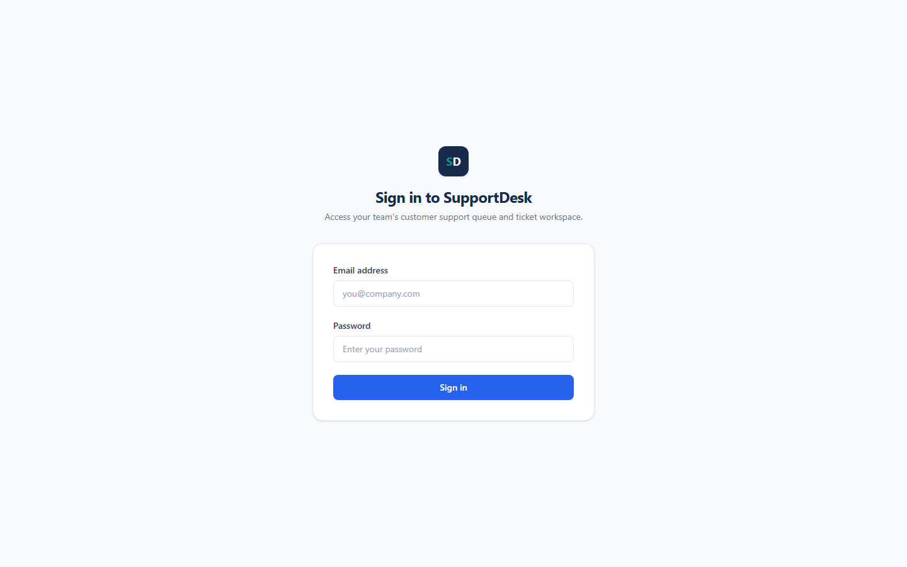

# Day 13 — Frontend Foundations — EOD

**Project:** SupportDesk — Customer Support Ticket Management System  
**Date:** 12 November 2026  
**Track:** Full-Stack TypeScript Engineering  

---

## 1. Branch and PR link
- **Branch:** `feat/web-login-foundation` (branched from `samarth` at `30df21e`)
- **Local Commits:** `1f70728`, `4e4fbae` (pending user push; PR link to be added after pushing `git push -u origin feat/web-login-foundation`)

---

## 2. Existing frontend/backend contract inspected
Inspected the existing `apps/api` backend before scaffolding `apps/web`:
- `apps/api/src/routes/index.ts` & `apps/api/src/routes/auth.routes.ts`: `POST /auth/login` and `POST /auth/register` (no `/auth/logout` or `/auth/me` endpoint exists).
- `apps/api/src/validations/auth.validation.ts`: `loginSchema` requires trimmed, lowercased valid `email` and `password` (`min(1, 'Password is required')`).
- `apps/api/src/services/auth.service.ts` & `auth.controller.ts`: `POST /auth/login` returns `200 OK` with standard envelope `{ data: { accessToken: string, user: { id, name, email, role } }, error: null, meta: {} }`.
- `apps/api/prisma/schema.prisma`: `Role` (`customer`, `agent`, `admin`), `TicketStatus` (`open`, `in_progress`, `waiting_on_customer`, `resolved`, `closed`), `TicketPriority` (`P1`, `P2`, `P3`, `P4`).
- `apps/api` CORS configuration allows `http://localhost:5173` (Vite dev server).

---

## 3. Wireframe/plan completed
- Completed **Google Stitch** desktop and mobile (`390px`) UI prototypes with organized module overview notes for leader review:
  - Stitch Project Link: `https://stitch.google.com/projects/5142013918804021795?pli=1`
- Planned the `apps/web` foundation around Navy (`#172B4D`), Blue (`#2563EB`), Teal (`#0D9488`), and Slate (`#F8FAFC` / `#334155` / `#64748B` / `#E2E8F0`) design tokens.

---

## 4. Folder structure created or updated
Created `apps/web/` with the following structure:
- `apps/web/package.json`, `apps/web/tsconfig.json`, `apps/web/vite.config.ts`, `apps/web/index.html`
- `apps/web/.env.example` (committed), `apps/web/.env` (gitignored)
- `apps/web/src/index.css` & `apps/web/src/test-setup.ts`
- `apps/web/src/lib/api-client.ts` & `apps/web/src/lib/auth.tsx`
- `apps/web/src/lib/__tests__/api-client.test.ts`
- `apps/web/src/components/AppLayout.tsx` & `apps/web/src/components/ProtectedRoute.tsx`
- `apps/web/src/components/__tests__/ProtectedRoute.test.tsx`
- `apps/web/src/features/tickets/api/tickets.api.ts`
- `apps/web/src/features/tickets/hooks/useTickets.ts`
- `apps/web/src/features/tickets/components/TicketsOverview.tsx`
- `apps/web/src/pages/LoginPage.tsx` & `apps/web/src/pages/TicketsPage.tsx`
- `apps/web/src/pages/__tests__/LoginPage.test.tsx`
- `apps/web/src/App.tsx` & `apps/web/src/main.tsx`

---

## 5. API client implementation
- Implemented a single shared typed HTTP client in `apps/web/src/lib/api-client.ts` (`apiClient.get`, `post`, `patch`, `delete`).
- Reads `import.meta.env.VITE_API_BASE_URL` with zero hardcoded URLs in UI components.
- Injects `Authorization: Bearer <token>` via `configureApiAuth(...)`.
- Maps backend `{ data: null, error: { code, message, details } }` error envelopes and network failures into typed `ApiError` instances, and triggers the unauthorized callback on HTTP `401`.
- Audited `apps/web/src` (excluding `__tests__`) to confirm `fetch(` appears only in `src/lib/api-client.ts`.

---

## 6. Environment variable configuration
- Committed `apps/web/.env.example` with `VITE_API_BASE_URL=http://localhost:3000`.
- Created local `apps/web/.env` with `VITE_API_BASE_URL=http://localhost:3000` (verified ignored by `.gitignore` and excluded from Git commits).

---

## 7. Login page and layout
- **`LoginPage` (`apps/web/src/pages/LoginPage.tsx`)**: Built with React Hook Form (`email` required + pattern validation, `password` required), accessible `<label htmlFor>` / `aria-invalid` / `aria-describedby`, loading state (`Signing in...` + disabled submit button to prevent double-submit), and `role="alert"` error banner.
- **`AppLayout` (`apps/web/src/components/AppLayout.tsx`)**: Responsive shell with a persistent `#172B4D` Navy desktop sidebar, mobile hamburger slide-over drawer so mobile content is never squished, and white top header displaying user name, Teal role badge, and `Sign out` button.
- **`TicketsPage` & `TicketsOverview`**: Protected `/tickets` landing view backed by TanStack Query (`useTickets`) with loading, error+retry, empty, desktop table, and mobile card views.

### Login Page Screenshot (`http://localhost:5173/login`)

---

## 8. Authentication/protected-route behaviour
- `AuthProvider` (`apps/web/src/lib/auth.tsx`) persists `{ accessToken, user }` in `localStorage` under `supportdesk_auth_session` and calls `POST /auth/login` with trimmed, lowercased email.
- `ProtectedRoute` redirects unauthenticated visitors from `/tickets` to `/login`.
- `PublicOnlyRoute` redirects authenticated users from `/login` to `/tickets`.
- Any `401` API response automatically clears the stored session via `configureApiAuth`.
- `/` and `*` fallback routes redirect cleanly to `/tickets`.

---

## 9. Manual scenarios executed and results
- **Visual Login Page Render (`http://localhost:5173/login`)**: Started Vite dev server (`npm --prefix apps/web run dev`) and captured headless Edge desktop (`1440x900`) screenshot confirming `Sign in to SupportDesk`, email/password inputs, and `Sign in` button render cleanly.
- **Architecture & Git Hygiene Audit**: Verified no `fetch(` or hardcoded `http://localhost` exists outside `api-client.ts` / tests, and confirmed `.env` is untracked while `.env.example` is committed.
- **Pending local end-to-end DB login**: Automated sandbox probe against `http://localhost:3000/health` could not complete inside the sandbox loopback environment; live `POST /auth/login` + `/tickets` browser flow should be run locally with `apps/api` + PostgreSQL running.

---

## 10. Tests run and actual output
- **TypeScript & Vite Production Build** (`npm --prefix apps/web run build` -> `tsc -b && vite build`):
  - Exited `0`: `✓ 96 modules transformed`, built `dist/index.html`, CSS (`21.07 kB`), and JS (`347.95 kB`).
- **Vitest Suite** (`npm --prefix apps/web test` -> `vitest run`):
  - `src/lib/__tests__/api-client.test.ts`: **3 passed**
  - `src/components/__tests__/ProtectedRoute.test.tsx`: **2 passed**
  - `src/pages/__tests__/LoginPage.test.tsx`: **3 passed**
  - **Total:** `Test Files  3 passed (3)` | `Tests  8 passed (8)`

---

## 11. AI review findings and verified fixes
- **Initial `LoginPage.test.tsx` import & constructor issue**: Replaced uninstalled `@testing-library/user-event` with built-in `fireEvent` from `@testing-library/react`, and updated `new ApiError(...)` to match positional constructor arguments `(status, code, message)`.
- **`api-client.test.ts` header assertion**: Updated `(init.headers as Headers).get(...)` to `(init.headers as Record<string, string>).Authorization` to match `api-client.ts`.
- **Re-verification**: Re-ran both `npm --prefix apps/web run build` and `npm --prefix apps/web test` after the final edits; both passed 100%.

---

## 12. Prompt Journal updated
- Appended **Entry 19 — Day 13: Frontend Foundations, Auth State, and Typed API Client (`apps/web`)** to `docs/prompt-journal.md`.

---

## 13. Blockers or deviations
- **Sandbox loopback restriction**: Live `apps/api` + PostgreSQL health/login probe could not complete over loopback inside the sandboxed terminal; unit/component tests and production build all ran and passed, and live Vite rendering of `/login` was verified outside the sandbox.

---

## 14. What I learned
- Inspecting backend Zod schemas (`loginSchema` trimming/lowercasing) and exact response envelopes (`{ data, error, meta }`) before generating frontend code prevents contract mismatches.
- Isolating HTTP transport and Bearer header injection inside a single `api-client.ts` module keeps UI components clean and makes auth/401 handling testable without a live server.

---

## 15. Term of the day — Wireframe
A **wireframe** is a low-fidelity visual blueprint of a screen or user flow that defines layout structure, content hierarchy, navigation, and key interactions before writing production UI code.
