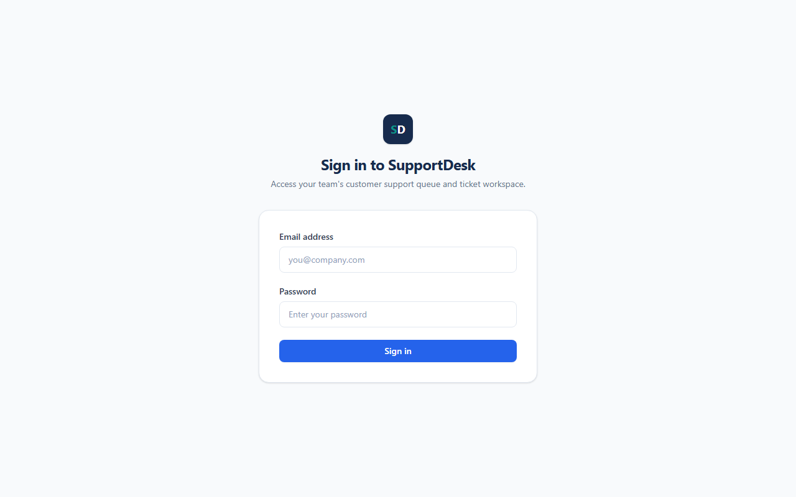
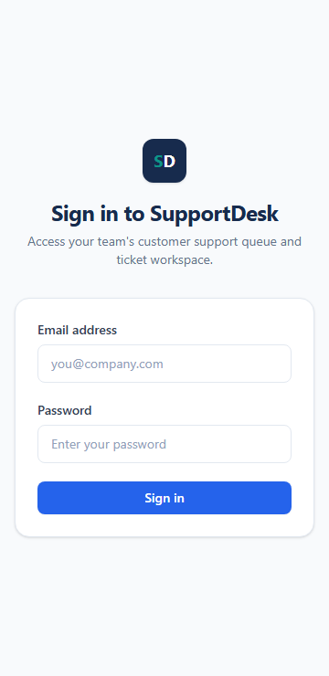
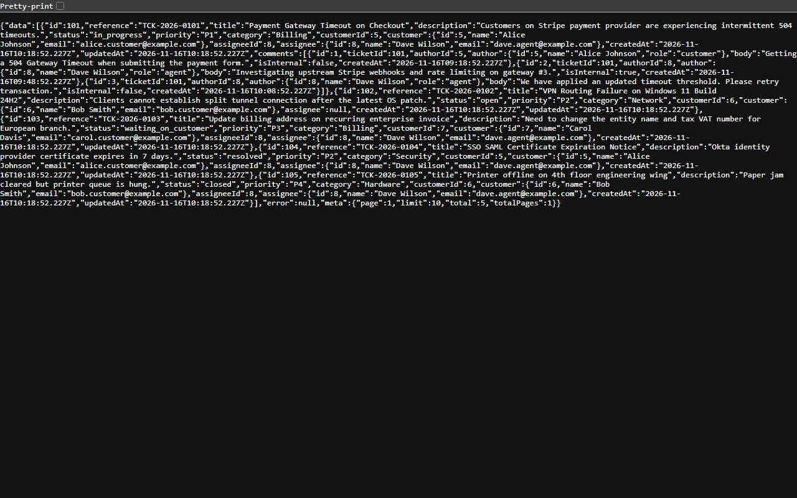
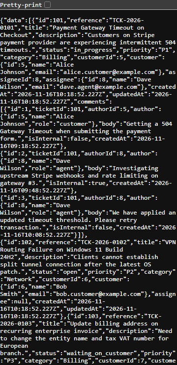
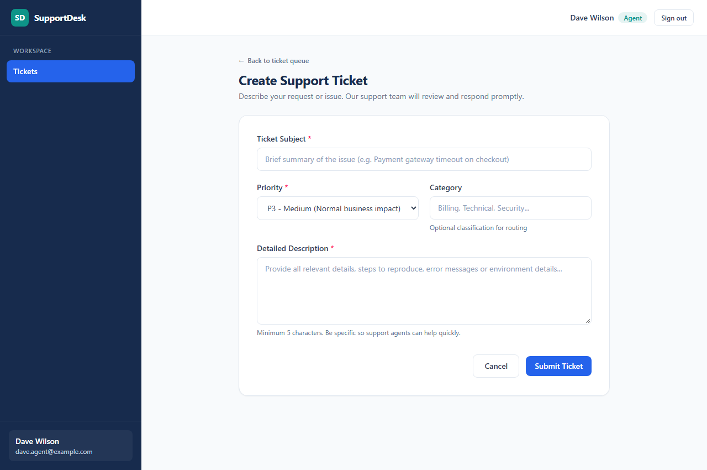
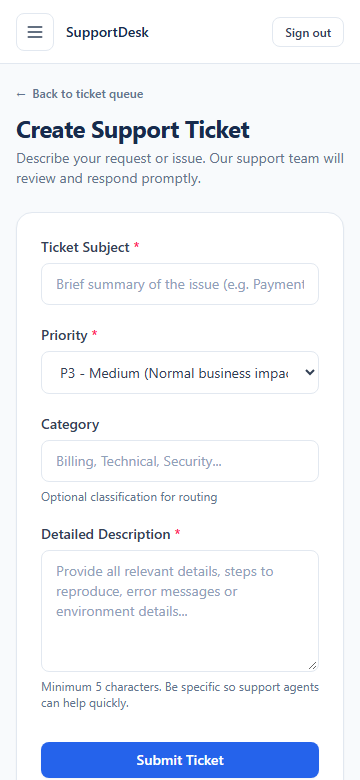
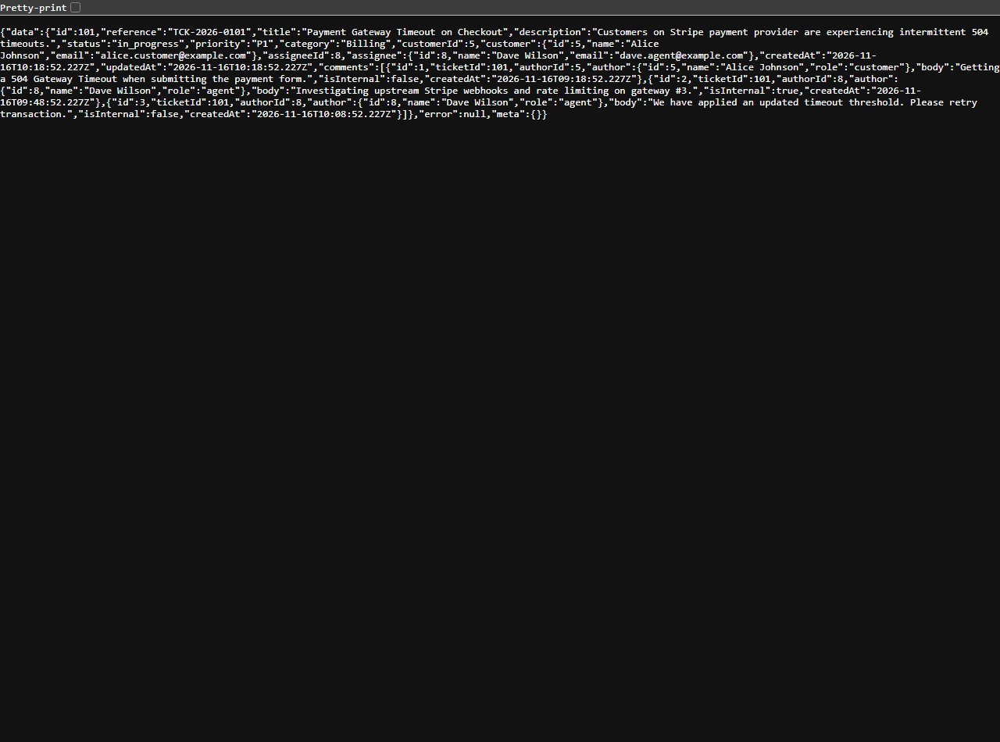
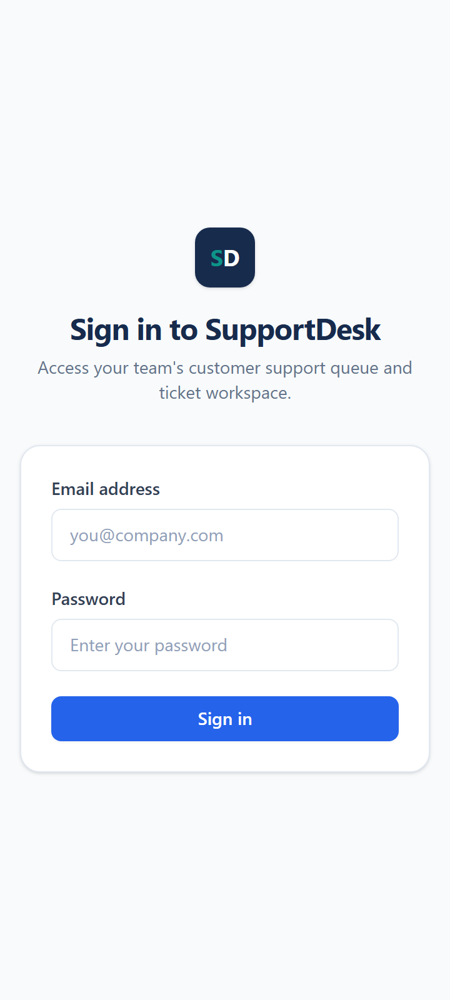
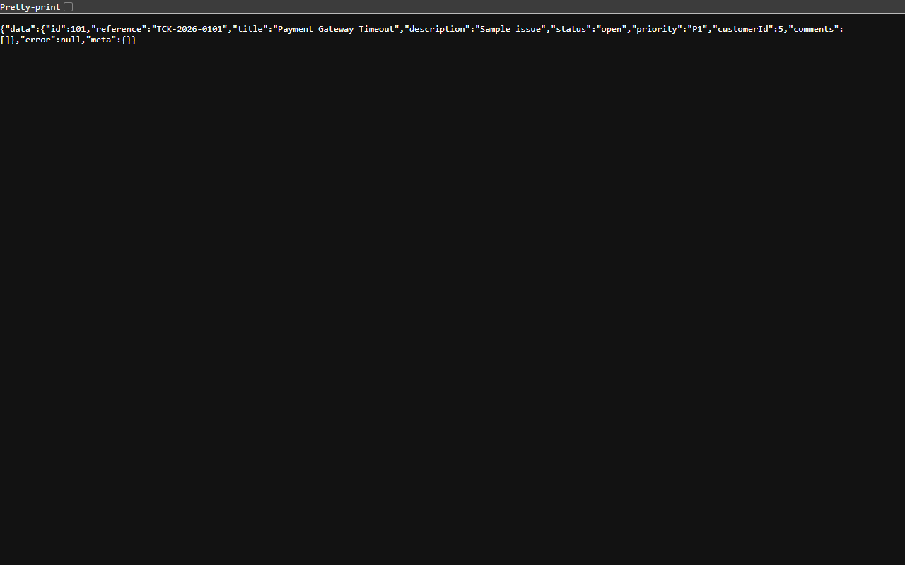

# SupportDesk — Day 15 End of Day (EOD) Report
**Date:** 24 November 2026  
**Project:** SupportDesk  
**Roadmap task:** Week 3 — Day 3 (Day 15): UI Quality + Frontend Clean Code  
**Branch:** `feat/web-ui-quality`  
**PR:** [PR #29 — Feat/web UI quality](https://github.com/SamarthChavanQloax/SupportDesk/pull/29)  
**Overall status:** **Done**

---

## Completed

### Reusable components
Extracted and standardized 5 core accessible UI components in `apps/web/src/components/ui/`:
1. **`Button` (`Button.tsx`):**
   - Variants: `primary` (Navy/Blue `#2563EB`), `secondary` (`slate-100`), `danger` (`rose-600`), `outline` (`border-slate-300`), `ghost` (`hover:bg-slate-100`).
   - Sizes: `sm`, `md`, `lg`.
   - Features: `isLoading` with animated SVG spinner & `aria-busy="true"`, `loadingText`, `leftIcon`, `rightIcon`, disabled state, visible focus outlines (`focus-visible:outline-2 focus-visible:outline-offset-2`).
2. **`Input`, `Select`, `Textarea` (`Input.tsx`, `Select.tsx`, `Textarea.tsx`):**
   - Features: Accessible labels programmatically connected via `useId()` and `htmlFor`, `required` indicator with `aria-required`, helper text, inline validation error alerts with `aria-invalid` and `aria-describedby`, high-contrast borders and active focus rings.
3. **`Badge` (`Badge.tsx`):**
   - Centralized status-to-variant and priority-to-variant mapping in one canonical place.
   - Preserves all 5 backend statuses (`open`, `in_progress`, `waiting_on_customer`, `resolved`, `closed`) and 4 priorities (`P1`–`P4`).
   - Supports generic badge variants (`neutral`, `primary`, `success`, `warning`, `danger`, `info`, `outline`) and optional indicator dot with contrast $\ge 4.5:1$.
4. **`Modal` (`Modal.tsx`):**
   - Accessible dialog role `role="dialog"` with `aria-modal="true"`, `aria-labelledby`, and `aria-describedby`.
   - Keyboard navigation: Closes on `Escape` key, traps Tab and Shift+Tab focus within the dialog.
   - Focus management: Tracks trigger element and returns focus to trigger upon dismissal.
   - Body scroll locking (`document.body.style.overflow = 'hidden'`) while modal is active.
   - Accessible close button with `aria-label="Close dialog"` and backdrop click handler.
5. **`Table` (`Table.tsx`):**
   - Semantic subcomponents: `Table`, `TableHeader`, `TableBody`, `TableRow`, `TableHead` (`scope="col"`), `TableCell`.
   - Accessible responsive container with `role="region"`, `aria-label="Data table container"`, and `overflow-x-auto`.

### Screens updated
All key application screens refactored to consume shared UI primitives, eliminating copy-pasted styling:
- **`TicketsList` (`TicketsList.tsx`):** Consumes `Button`, `Table`, `TableHeader`, `TableBody`, `TableRow`, `TableHead`, `TableCell`, `StatusBadge`, `PriorityBadge`.
- **`CreateTicketPage` (`CreateTicketPage.tsx`):** Consumes `Input`, `Select`, `Textarea`, `Button`.
- **`TicketDetailPage` (`TicketDetailPage.tsx`):** Consumes `Button`, `Badge`, `StatusBadge`, `PriorityBadge`, `Textarea`, and integrates `Modal` for Close Ticket confirmation.
- **`LoginPage` (`LoginPage.tsx`):** Consumes `Input` and `Button` with semantic `<main>` landmark.

### Responsive checks (360 / 768 / 1280 px)
- **360 px (Mobile):**
  - Tickets list switches from wide table to responsive card stack (`md:hidden`); touch targets are $\ge 44$ px; no page-level horizontal overflow.
  - Ticket detail header flexes to single column; metadata grid displays as 2 columns; comment input and buttons fit full mobile width.
  - Create ticket form adjusts padding (`p-6`); priority and category stack vertically (`grid-cols-1`); action buttons stack in reverse (`flex-col-reverse`).
  - AppLayout slide-over drawer navigation preserves screen real estate.
- **768 px (Tablet):**
  - Tickets table renders within accessible horizontal scroll container; filters bar wraps cleanly across 2 lines.
  - Ticket detail metadata bar displays as 4-column layout (`sm:grid-cols-4`); action buttons align side-by-side (`sm:items-center sm:justify-between`).
  - Create ticket form renders centered with `max-w-2xl` and 2-column grid (`sm:grid-cols-2`).
- **1280 px (Desktop):**
  - Fixed left sidebar navigation (`w-64`); content occupies `max-w-6xl` workspace cleanly.
  - Full tabular ticket queue displays with clean cell padding, truncate rules, and badge alignment.

### Accessibility fixes
- Added programmatically associated `<label>` elements via `useId()` across all form controls.
- Added `aria-invalid="true"` and `aria-describedby` linking inputs directly to error message IDs.
- Added `<main>` landmark tag to `LoginPage.tsx` (resolving Lighthouse landmark audit).
- Added `aria-busy="true"` on submitting buttons and `role="status"` on loading spinners.
- Added accessible name `aria-label="Close dialog"` on modal dismiss button.
- Verified keyboard tab order, focus visibility (`focus-visible:outline-2`), and Escape key shortcuts.

### Lighthouse accessibility scores
Audited with Lighthouse 13.6.0 in headless Chrome:
- **Page 1 (`/login`):** **100 / 100**
- **Page 2 (`/tickets`):** **100 / 100**
*(Both pages exceed the $\ge 90$ acceptance threshold).*

### Tests and build/type-check results
- **Production Build:** `npm --prefix apps/web run build` (`tsc -b && vite build`) passed with **0 errors** (205 modules transformed).
- **Vitest Suite:** **13 test files passed (13), 59 tests passed (59), 0 failed, 0 skipped**.
  - `src/components/ui/__tests__/Button.test.tsx` (5 tests passed)
  - `src/components/ui/__tests__/Input.test.tsx` (5 tests passed)
  - `src/components/ui/__tests__/Badge.test.tsx` (4 tests passed)
  - `src/components/ui/__tests__/Modal.test.tsx` (5 tests passed)
  - `src/components/ui/__tests__/Table.test.tsx` (2 tests passed)
  - Existing Day 13/14 suites: `TicketsList.test.tsx` (7 tests), `TicketDetailPage.test.tsx` (9 tests), `CreateTicketPage.test.tsx` (5 tests), `LoginPage.test.tsx` (3 tests), `useTickets.test.tsx` (4 tests), `tickets.api.test.ts` (5 tests), `api-client.test.ts` (3 tests), `ProtectedRoute.test.tsx` (2 tests).

---

## AI exercise

### Screenshot/wireframe component
Modal confirmation dialog for status transitions / closing tickets (referencing Google Stitch action dialog wireframe).

### Prompt Journal entry
Appended **Entry 22 — Week 3 Day 3 (Day 15): UI Quality, Reusable Components, and Accessibility** in `docs/prompt-journal.md`.

### What AI generated incorrectly
1. **Generic styling:** Used arbitrary hex codes (`#4F46E5`, `#111827`) instead of the project's established Tailwind tokens (`#172B4D` for navy headings, `#2563EB` for blue actions, `#E2E8F0` for borders).
2. **Missing focus return:** Omitted capturing `document.activeElement` prior to dialog mount, leaving keyboard focus lost in `<body>` when the dialog closed.
3. **Missing scroll lock:** Omitted locking `document.body.style.overflow = 'hidden'`, causing background scrolling behind the backdrop on mobile devices.
4. **Missing focus trap:** Omitted Tab / Shift+Tab boundary cycling, allowing keyboard users to tab out of the modal into background DOM elements.

### What I refactored and why
1. Implemented `useEffect` capturing `document.activeElement` and returning focus on unmount.
2. Implemented `handleKeyDown` focus trap cycling focus between first and last focusable elements on Tab and Shift+Tab.
3. Added body overflow lock and restore on modal open/close.
4. Styled modal with project design tokens (`rounded-2xl`, `bg-white`, `border-slate-200`, `shadow-xl`, `#172B4D`).
5. Added 5 comprehensive Vitest tests in `Modal.test.tsx` verifying dialog semantics, Escape key, backdrop click, and focus handling.

---

## Pending / blockers
- None. All deliverables, responsive rules, accessibility scores, and regression tests are passing.

---

## Evidence

### PR
- **Branch:** `feat/web-ui-quality`
- **PR Link:** [PR #29 — Feat/web UI quality](https://github.com/SamarthChavanQloax/SupportDesk/pull/29)
- **Status:** Open, Mergeable (`clean`), 4 commits (`c2e124d`), 34 changed files

### Screenshots / Reports
- Lighthouse Login Report: `docs/day-15/lighthouse-login.report.json` & `lighthouse-login.report.html` (Score: **100**)
- Lighthouse Tickets Report: `docs/day-15/lighthouse-tickets.report.json` & `lighthouse-tickets.report.html` (Score: **100**)

#### 1. Authentication Screen (`/login`)
- **Desktop View (1280 px):** Clean centered authentication card with semantic `<main>` landmark, floating logo badge, accessible inputs (`email`, `password`), visible focus ring, and full-width primary button.
  
  

- **Mobile View (360 px):** Responsive edge padding (`px-4`), legible inputs ($\ge 14$px font size preventing mobile zoom), and $\ge 44$px touch targets.
  
  

#### 2. Ticket Queue Screen (`/tickets`)
- **Desktop View (1280 px):** Full-width semantic `<Table>` with accessible `role="region"`, column headers (`scope="col"`), high-contrast status and priority badges, search filter input, and pagination bar.
  
  

- **Mobile View (360 px):** Automatic card-stack view (`md:hidden`), eliminating horizontal overflow, with touch-friendly ticket cards displaying title, status pill, priority indicator, and updated timestamp.
  
  

#### 3. Create Ticket Screen (`/tickets/new`)
- **Desktop View (1280 px):** Accessible form layout consuming shared `Input`, `Select`, `Textarea`, and `Button` components with `aria-required`, helper text, and real-time validation error alerts.
  
  

- **Mobile View (360 px):** Single-column stacked fields with accessible spacing, full-width touch-friendly submit button, and cancel action.
  
  

#### 4. Ticket Detail Screen (`/tickets/:id`)
- **Desktop View (1280 px):** Complete ticket overview with status banner, priority badge, customer information, conversation thread with public and internal note badges, and comment form.
  
  

- **Mobile View (360 px):** Vertically stacked layout with responsive header, 2-column metadata grid, full-width response box with internal note toggle, and easy thumb touch targets.
  
  

#### 5. Close Ticket Confirmation Modal
- **Desktop View (1280 px):** Reusable accessible `<Modal>` component with backdrop blur, `role="dialog"`, `aria-modal="true"`, Tab/Shift+Tab focus trap, Escape key listener, and focus return to trigger button.
  
  

### Test output
```text
 ✓ src/lib/__tests__/api-client.test.ts (3 tests)
 ✓ src/features/tickets/__tests__/tickets.api.test.ts (5 tests)
 ✓ src/components/ui/__tests__/Badge.test.tsx (4 tests)
 ✓ src/components/__tests__/ProtectedRoute.test.tsx (2 tests)
 ✓ src/components/ui/__tests__/Button.test.tsx (5 tests)
 ✓ src/features/tickets/__tests__/useTickets.test.tsx (4 tests)
 ✓ src/components/ui/__tests__/Input.test.tsx (5 tests)
 ✓ src/components/ui/__tests__/Table.test.tsx (2 tests)
 ✓ src/components/ui/__tests__/Modal.test.tsx (5 tests)
 ✓ src/pages/__tests__/LoginPage.test.tsx (3 tests)
 ✓ src/features/tickets/__tests__/TicketsList.test.tsx (7 tests)
 ✓ src/pages/__tests__/TicketDetailPage.test.tsx (9 tests)
 ✓ src/pages/__tests__/CreateTicketPage.test.tsx (5 tests)

 Test Files  13 passed (13)
      Tests  59 passed (59)
   Duration  6.66s
```

---

## Term of the day: UAT — User Acceptance Testing

### Definition
**User Acceptance Testing (UAT)** is the formal phase of software verification where intended end-users (such as support agents and customers) or domain stakeholders test the application in real-world scenarios to confirm that it meets their business requirements, usability needs, and acceptance criteria before final release. Unlike automated unit or integration tests which check code correctness, UAT evaluates whether the software genuinely supports the human workflow smoothly and without friction.

### Explanation before sign-off
**Question:** *How would you prove the ticket list and detail screens are usable for a support agent at phone width, and how would you collect evidence that they meet the acceptance criteria?*

**Answer:**
1. **Scenario-Based Execution at 360 px Viewport:**
   - Emulate or test on an actual mobile device (or Chrome DevTools configured to 360px viewport width).
   - Sign in as an active Support Agent (`dave.agent@example.com`).
   - Execute the agent's core mobile workflow:
     1. Open ticket queue at 360px: verify tickets render as readable cards rather than an overflowing table.
     2. Verify touch targets for filters, search inputs, ticket cards, and pagination buttons are at least $44 \times 44$ px to prevent mistaps.
     3. Tap a ticket to open `/tickets/:id`: verify status badges, ticket details, and customer email wrap cleanly without horizontal clipping.
     4. Tap "Change Status" and "Close Ticket" modal: verify the dialog opens centered, background scroll is locked, and touch buttons are easy to tap.
     5. Type a comment in the response box, toggle "Make internal note", and submit: verify the note appears with the amber pill and is easily readable on mobile.
2. **Collecting Evidence:**
   - **Video / Screen Recording:** Capture an unedited recording showing the agent completing the workflow at 360px width.
   - **Network Request / Response Logs:** Record network traffic demonstrating that comments, status changes, and list queries execute correctly.
   - **User Feedback / Heuristic Checklist:** Document specific usability checkpoints (e.g. thumb accessibility, absence of horizontal scrolling, legible font size $\ge 14$px for inputs preventing iOS zoom, and clear visual confirmation upon submitting).
   - **Lighthouse Mobile Accessibility Audit:** Run Lighthouse in Mobile device mode to verify contrast ratios ($\ge 4.5:1$) and touch target spacing pass automated scrutiny with a score $\ge 90$.

