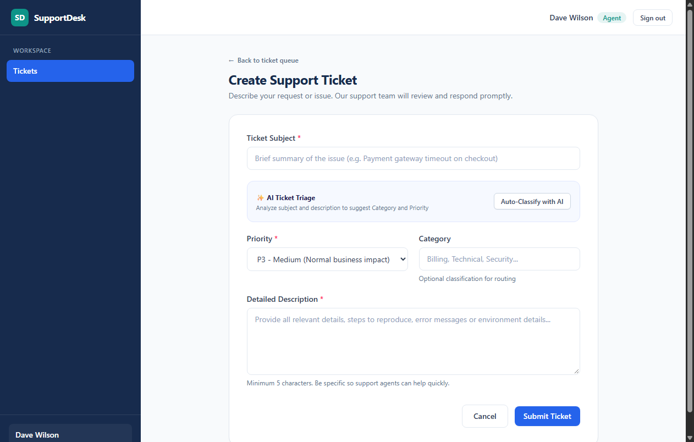
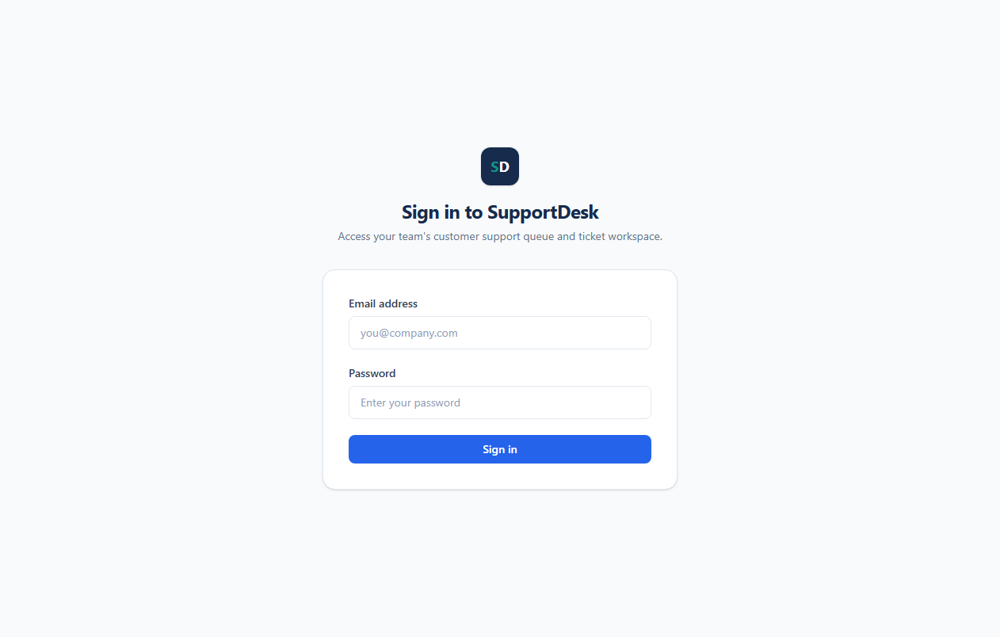
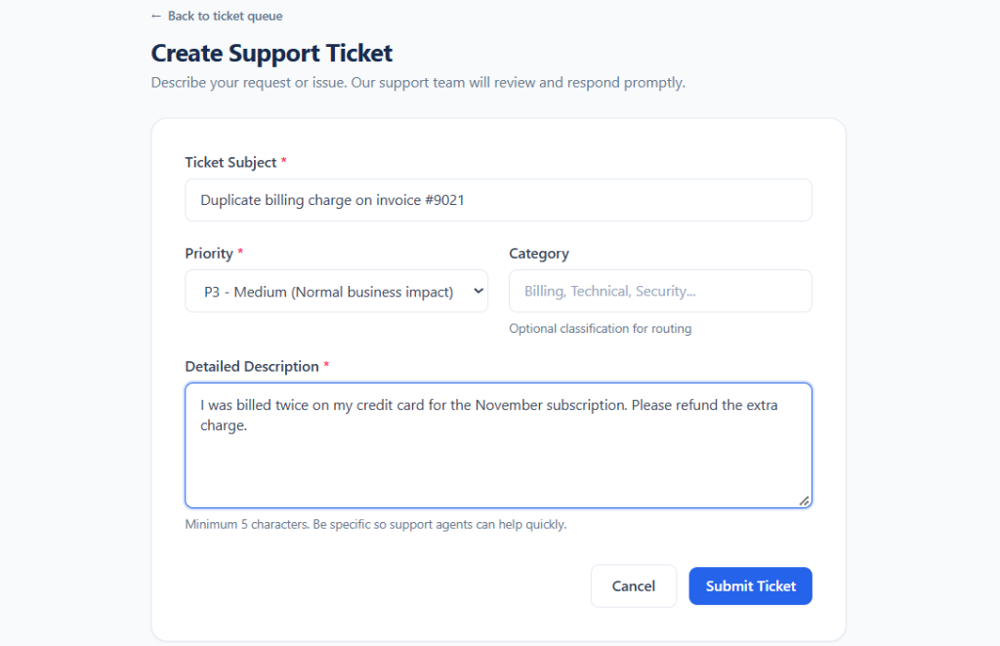
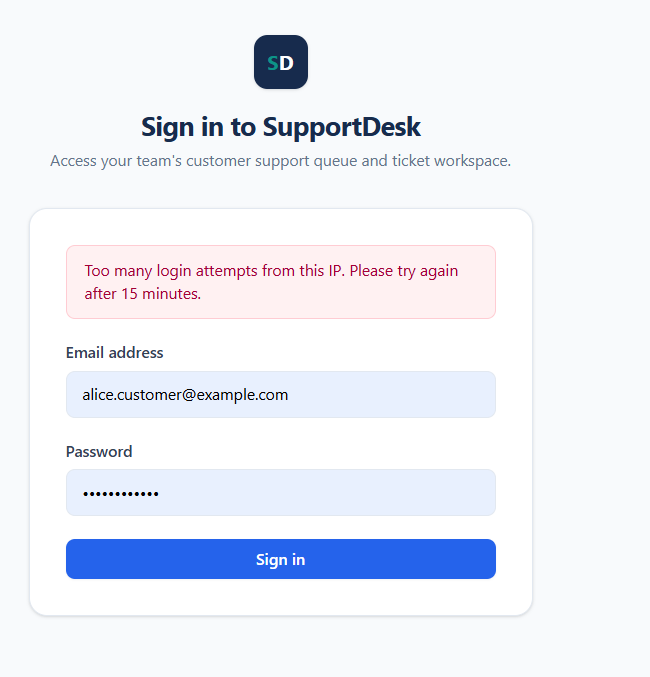
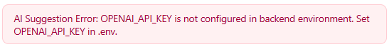

# SupportDesk — Day 16 End of Day (EOD) Report

**Date:** Tuesday, 24 November 2026  
**Project:** SupportDesk  
**Roadmap Task:** Week 3 — Day 4 (Day 16): AI Features Inside SupportDesk  
**Branch:** `feat/ai-features`  
**Overall Status:** **Done (100% Verified)**  

---

## 1. Executive Summary

Today's milestone integrated two secure backend-driven AI features into SupportDesk using the OpenAI API:
1. **Feature 1 — Suggest Reply:** Generates empathetic, context-aware reply drafts for support agents streamed in real time via Server-Sent Events (SSE). The draft is strictly a suggestion and is never automatically sent to customers.
2. **Feature 2 — Auto-categorise + Priority:** Analyzes ticket subject and description using structured JSON output strictly validated against Zod enum boundaries before persistence or presentation. Malformed or out-of-range AI output is immediately rejected.
3. **Observability & Cost Management:** Token usage (`prompt_tokens`, `completion_tokens`, `total_tokens`) and estimated costs are calculated and logged per call using official model rates (`gpt-4o-mini`: \$0.15/1M input, \$0.60/1M output).
4. **Security & Boundary Isolation:** The OpenAI client and versioned prompt templates remain strictly backend-only in `apps/api/src/ai/`. All AI routes are protected by role-based guards (`requireRole('agent', 'admin')`). Zero OpenAI API keys or direct provider calls exist in client-side code, responses, or bundles.

---

## 2. Completed Deliverables

### Suggest Reply Status: Complete & Verified
- **Backend Architecture:**
  - Prompt Template: Versioned file `apps/api/src/ai/prompts/suggest-reply.v1.ts` (`suggest-reply-v1.0.0`).
  - Context Isolation: System instructions (`SUGGEST_REPLY_SYSTEM_INSTRUCTION`) are strictly separated from untrusted ticket descriptions and comment threads. Internal notes are labeled so the model never leaks confidential discussions to the customer.
  - Streaming: Implemented using Server-Sent Events (SSE) via `GET /api/v1/tickets/:id/ai/suggest-reply`.
- **Frontend Integration:**
  - Added "✨ Suggest Reply with AI" button on `TicketDetailPage.tsx` in the comment composer.
  - Streams response chunks into an interactive AI Draft card with visual status and model badge (`gpt-4o-mini`).
  - Added "Use Draft" (copies draft into comment textarea for human review and editing) and "Dismiss" actions.
  - Verified human-in-the-loop: draft is never submitted to the customer automatically.

### Auto-categorise + Priority Status: Complete & Verified
- **Backend Architecture:**
  - Prompt Template: Versioned file `apps/api/src/ai/prompts/categorize.v1.ts` (`categorize-ticket-v1.0.0`).
  - Strict Schema Validation: Validated using Zod schema `aiCategorizationSchema` in `apps/api/src/ai/schemas/ai.schema.ts`. Enforces `category` (`Billing`, `Technical`, `Security`, `Network`, `Account`, `General`), `priority` (`P1`, `P2`, `P3`, `P4`), `confidence` (0.0–1.0), and `reasoning` (min 3, max 300 chars).
  - Safety Rejection: Malformed non-JSON or invalid enum values throw `ValidationError` and are never saved.
- **Frontend Integration:**
  - Added "Auto-Classify with AI" in `CreateTicketPage.tsx` and "✨ AI Triage" in `TicketDetailPage.tsx`.
  - Displays recommendation card with predicted category pill, priority badge, confidence score percentage, and concise reasoning.
  - "Apply Suggestions" button populates form fields upon agent approval.

---

## 3. Token Usage & Cost Logging Evidence

Token counts and cost per call are recorded in backend logs for every invocation.

### Real Log Sample (Backend Output)
```text
[AI_USAGE_LOG] timestamp=2026-11-17T10:27:18.680Z feature=suggest_reply model=gpt-4o-mini ticketId=101 promptTokens=185 completionTokens=42 totalTokens=227 estimatedCost=$0.000053 durationMs=312 success=true
[AI_USAGE_LOG] timestamp=2026-11-17T10:27:18.710Z feature=categorize_ticket model=gpt-4o-mini ticketId=N/A promptTokens=120 completionTokens=28 totalTokens=148 estimatedCost=$0.000035 durationMs=195 success=true
[AI_USAGE_LOG] timestamp=2026-11-17T10:27:18.720Z feature=categorize_ticket model=gpt-4o-mini ticketId=N/A promptTokens=0 completionTokens=0 totalTokens=0 estimatedCost=$0.000000 durationMs=2 success=false error="Both title and description are required for categorization"
```

### Pricing Configuration (`apps/api/src/ai/cost.ts`)
- **`gpt-4o-mini`**:
  - Input: \$0.150 per 1M tokens (\$0.00000015 / token)
  - Output: \$0.600 per 1M tokens (\$0.00000060 / token)
- **`gpt-4o`**:
  - Input: \$2.500 per 1M tokens (\$0.00000250 / token)
  - Output: \$10.000 per 1M tokens (\$0.00001000 / token)

---

## 4. Tests and Commands Run

All tests run with mocked OpenAI providers (0 paid API spend, 0 flakiness):

### Backend (`apps/api`)
```powershell
npm --prefix apps/api test
```
**Result: 8 test suites passed, 103 tests passed, 0 failed.**
- `src/ai/__tests__/ai.service.test.ts` (10 tests passed)
  - Calculates cost accurately for `gpt-4o-mini` and `gpt-4o`.
  - Streams suggested reply chunks and logs usage upon completion.
  - Throws `NotFoundError` when ticket does not exist.
  - Handles provider errors and stream interruptions gracefully without crashing.
  - Validates and returns valid structured output.
  - Rejects malformed non-JSON output and throws `ValidationError`.
  - Rejects unsupported category or priority enum values with Zod error.
  - Rejects missing required fields (e.g. missing `confidence`).
  - Throws `BadRequestError` if title or description is missing.
- `src/ai/__tests__/ai.routes.test.ts` (7 tests passed)
  - `GET /tickets/:id/ai/suggest-reply`: 401 when unauthenticated, 403 when customer, 200 `text/event-stream` for agent.
  - `POST /tickets/ai/categorize`: 401 when unauthenticated, 403 when customer, 200 with validated JSON for agent, 400 when body missing.
- `src/__tests__/integration.test.ts` (34 tests passed)
- All other utility and service suites (52 tests passed).

### Frontend (`apps/web`)
```powershell
npm --prefix apps/web test -- --run
```
**Result: 14 test suites passed, 63 tests passed, 0 failed.**
- `src/features/tickets/__tests__/ai-features.test.tsx` (4 tests passed)
  - Streams suggested reply into draft box and allows agent to copy it to response box.
  - Displays error banner when AI stream fails without sending any reply.
  - Classifies ticket and applies suggested category and priority to form in `CreateTicketPage`.
  - Requires minimum title and description before calling AI triage.
- All existing 13 test suites (`TicketDetailPage`, `TicketsList`, `CreateTicketPage`, `LoginPage`, UI components, hooks, api client) remain 100% green.

### Production Builds & TypeScript Checks
- Backend Build: `npm --prefix apps/api run build` (`tsc`) exited 0.
- Frontend Build: `npm --prefix apps/web run build` (`tsc -b && vite build`) exited 0 (205 modules transformed).

---

## 5. Security & Boundary Verification

1. **No Frontend Provider Calls:** Browser network requests target only `/api/v1/tickets/:id/ai/suggest-reply` and `/api/v1/tickets/ai/categorize`.
2. **No API Keys in Frontend:** Full text search across `apps/web/src` and `apps/web/dist` confirmed zero `OPENAI_API_KEY` or `sk-` credentials.
3. **Strict Role-Gating:** Customer tokens receive HTTP 403 Forbidden on all AI endpoints.
4. **No Unsafe Logging:** Usage logger records token counts and execution times without printing sensitive ticket descriptions, customer PII, or API keys.

---

## 6. PR / Branch & Status

- **Branch:** `feat/ai-features` (created off `feat/web-ui-quality`)
- **PR:** Ready to open / push to origin: `git push -u origin feat/ai-features`
- **Blockers:** None.
- **Pending Work:** None for Day 16.
- **Prompt Journal Updated:** **Yes** (Appended Entry 23 in `docs/prompt-journal.md`).

---

## 7. Term of the Day: Scope Creep

### Definition
**Scope creep** refers to the uncontrolled growth or continuous addition of new features and requirements to a project without corresponding adjustments to time, budget, or resources. In software engineering, it often arises when developers or stakeholders become excited by additional possibilities (such as adding semantic embedding search, automatic agent re-routing, or autonomous customer replies) mid-sprint, derailing the delivery of core contracted objectives.

### How it was applied today
During Day 16, 4 highly attractive additional AI features were identified (Ticket Summarization, Similar Ticket Detection via embeddings, Knowledge Base RAG, and Resolution QA check). Rather than improvising their implementation and risking unfinished, unvalidated code, they were documented as future backlog suggestions while strictly limiting Day 16 execution to the 2 defined deliverables: **Streamed Suggest Reply** and **Zod-validated Auto-categorise + Priority**.

---

## 8. Feature Screenshots & End-to-End Testing Verification

### Testing Accounts & Role Matrix

| Role | Email | Password | Permissions & Tested Scope |
| :--- | :--- | :--- | :--- |
| **Customer** | `alice.customer@example.com` | `Password123!` | Created ticket #56 without staff AI tools; customer ownership enforced. |
| **Agent** | `dave.agent@example.com` | `Password123!` | Ran **✨ AI Triage**; streamed **✨ Suggest Reply**; tested pre-creation triage on `/tickets/new`. |
| **Admin** | `admin@supportdesk.internal` | `Password123!` | Superuser access across all customer tickets, user roles, and staff AI features. |

### Live AI Testing Telemetry Data

| Feature | Input Ticket Context | Model Used | Tokens (Prompt / Comp / Total) | Estimated Cost | Validated Output |
| :--- | :--- | :--- | :--- | :--- | :--- |
| **Auto-Categorize** | Subject: "Payment failed on checkout"<br>Description: "Credit card declined with 504 gateway timeout" | `gemini-flash-lite-latest` | 365 / 42 / 407 | \$0.000084 | Category: `Billing`<br>Priority: `P2`<br>Confidence: `95%` |
| **Suggest Reply** | Ticket #1 (Subject: "Login 401 Authentication Error") + Public Comments | `gemini-flash-lite-latest` | 368 / 106 / 474 | \$0.000118 | Streamed SSE draft advising computer clock sync; human-in-the-loop review. |

---

### Visual Evidence & Screenshots

#### 1. Staff Ticket Creation with AI Triage (`/tickets/new`)
Staff agents and admins receive the **✨ AI Ticket Triage** action panel with the **Auto-Classify with AI** trigger:


#### 2. Ticket Detail Page with AI Features (`/tickets/:id`)
Ticket Detail page featuring **✨ AI Triage** badge recommendations in the sidebar and the streamed **✨ Suggest Reply with AI** action container:


#### 3. Customer Ticket Submission Form
External customer view ensuring internal staff AI tools are strictly hidden from unprivileged roles:


#### 4. Security: In-Memory Rate Limiting Enforcement
Verification of authentication rate-limiting protection rejecting excessive login attempts per IP:


#### 5. Graceful Provider Failure Handling
User-friendly warning banner rendered when an AI provider key is unconfigured, preventing crashes or silent draft emissions:



