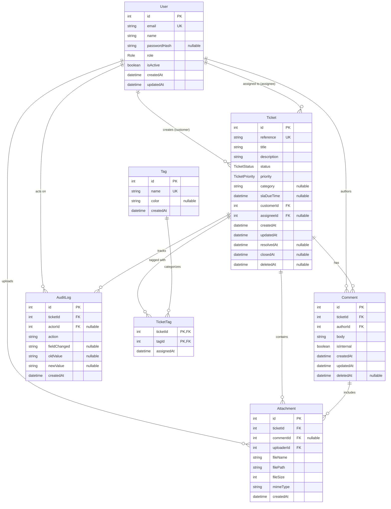

# SupportDesk — Day 8 End of Day (EOD) Report
## Database Design with AI

---

### 1. Intern and Project Information
- **Intern Name:** SupportDesk Intern (Pair Programming with Antigravity AI)
- **Project Name:** SupportDesk — Customer Support Ticket Management System
- **Repository:** `D:\SupportD\SupportDesk`
- **Assigned Mentor / Lead:** Senior Database Architect & Engineering Mentor

### 2. Date and Curriculum Information
- **Curriculum Day:** Week 2, Day 2 (Overall Day 8)
- **Date:** Thursday, 5 November 2026 / Friday, 6 November 2026
- **Theme:** Turning Product Requirements into a Relational Database Design with AI assistance

### 3. Primary Assignment Goal
Design and implement the foundational relational database schema for SupportDesk using Prisma ORM and PostgreSQL 16. Verify the schema via an automated migration on an empty local database running inside Docker, implement a standalone CSV-to-JSON data pipeline, seed exactly 50 fictional support tickets, generate an interactive Mermaid ERD, and document all AI-assisted architecture decisions.

### 4. Git Branch and Submission Information
- **Previous Working Branch:** `feature/day-7-clean-code-mvc` (commit `0cae403`)
- **Target Feature Branch:** `feature/day-8-database-design`
- **Base Branch:** `main`
- **Target Pull Request Title:** `feat(database): add initial SupportDesk schema, migrations, and seed data`

### 5. Summary of Completed Deliverables
1. **Requirements & Entity Analysis:** Completed gap analysis separating draft PRD items from Day 8 curriculum requirements in [`docs/database-design-notes.md`](../database-design-notes.md).
2. **PostgreSQL via Docker Compose:** Configured [`docker-compose.yml`](../../docker-compose.yml) running `postgres:16-alpine` on host port `5433` (preventing collision with Windows port 5432).
3. **Prisma Schema Definition:** Authored and validated 7 models (`User`, `Ticket`, `Comment`, `Tag`, `TicketTag`, `Attachment`, `AuditLog`) with native enums in [`apps/api/prisma/schema.prisma`](../../apps/api/prisma/schema.prisma).
4. **First Database Migration:** Successfully generated and executed migration `20261106063825_init_supportdesk_database`.
5. **CSV-to-JSON Ingestion Tool:** Created reusable TypeScript parser in [`apps/api/tools/csv-to-json.ts`](../../apps/api/tools/csv-to-json.ts).
6. **50 Fictional Sample Tickets:** Converted [`apps/api/data/sample-tickets.csv`](../../apps/api/data/sample-tickets.csv) to [`apps/api/data/sample-tickets.json`](../../apps/api/data/sample-tickets.json).
7. **Database Seeding:** Executed [`apps/api/prisma/seed.ts`](../../apps/api/prisma/seed.ts) inserting 6 users, 6 tags, exactly 50 tickets, 2 sample comments, and 1 audit log.
8. **Visual Mermaid ERD:** Created comprehensive interactive diagram in [`docs/supportdesk-erd.md`](../supportdesk-erd.md) and embedded below.
9. **Prompt Journal Entries:** Recorded Entries 9, 10, and 11 in 6-box structure within [`docs/prompt-journal.md`](../prompt-journal.md).

---

### 6. Database Architecture Overview
The database architecture follows Third Normal Form (3NF) principles tailored for an event-driven customer support ticketing system:
- **Core Entities:** `users`, `tickets`, `comments`, `tags`, `ticket_tags`, `attachments`, `audit_logs`.
- **Identity & Keys:** Auto-incrementing integer surrogate primary keys for operational performance and sequential indexing; unique business reference codes (`reference`) on tickets.
- **Relational Integrity:** Explicit foreign keys with guarded referential actions (`Restrict` on core audit entities, `Cascade` on sub-resources, `SetNull` on agent assignments).
- **Naming Conventions:** Prisma PascalCase models mapped to PostgreSQL snake_case tables and columns using `@@map` and `@map`.

---

### 7. Entities and Relationships Breakdown Table

| Model | DB Table | Purpose | Primary Key | Foreign Keys | Relationships |
| :--- | :--- | :--- | :--- | :--- | :--- |
| **`User`** | `users` | Authenticated customers, agents, admins | `id` (Int) | None | `1:N` to Tickets (`customerId` & `assigneeId`), Comments, Attachments, AuditLogs |
| **`Ticket`** | `tickets` | Core support request unit | `id` (Int) | `customerId`, `assigneeId` | `N:1` to User; `1:N` to Comments, Attachments, TicketTags, AuditLogs |
| **`Comment`** | `comments` | Conversational message thread | `id` (Int) | `ticketId`, `authorId` | `N:1` to Ticket; `N:1` to User; `1:N` to Attachments |
| **`Tag`** | `tags` | Classification taxonomy labels | `id` (Int) | None | `N:M` to Tickets via `TicketTag` |
| **`TicketTag`**| `ticket_tags` | Explicit junction table | `(ticketId, tagId)` | `ticketId`, `tagId` | `N:1` to Ticket; `N:1` to Tag |
| **`Attachment`**| `attachments`| File attachments metadata | `id` (Int) | `ticketId`, `commentId`, `uploaderId` | `N:1` to Ticket; `N:1` to Comment; `N:1` to User |
| **`AuditLog`** | `audit_logs` | Immutable change trail | `id` (Int) | `ticketId`, `actorId` | `N:1` to Ticket; `N:1` to User (optional) |

---

### 8. Enums and Custom Types

```prisma
enum Role {
  customer
  agent
  admin
}

enum TicketStatus {
  open
  in_progress
  waiting_on_customer
  resolved
  closed
}

enum TicketPriority {
  P1
  P2
  P3
  P4
}
```

*Design rationale:* Native PostgreSQL ENUM types enforce values at the storage engine level, preventing illegal status transitions or typo anomalies without requiring external check tables.

---

### 9. Constraints and Business Rules Implemented
1. **User Identity:** `users.email` is decorated with `@unique` to ensure strictly single-tenant user identification.
2. **Ticket Reference:** `tickets.reference` is marked `@unique` ensuring standardized human-readable references (`TCK-2026-XXXX`).
3. **Tag Identity:** `tags.name` is marked `@unique` preventing duplicate category taxonomy records.
4. **Internal Comment Privacy:** `comments.isInternal` defaults to `false`. When `true`, comments are hidden from customers and visible only to agents/admins.
5. **Resolution & Closure Timestamps:** `tickets.resolvedAt` and `tickets.closedAt` are nullable and populated during terminal workflow states.
6. **Soft Delete Lifecycle:** `tickets.deletedAt` and `comments.deletedAt` permit graceful archiving before database purge.
7. **Junction Table Uniqueness:** `ticket_tags` uses a composite primary key `@@id([ticketId, tagId])`, preventing duplicate tagging.

---

### 10. Indexes Created and Query Justifications

| Index Name / Columns | Target Table | Justification & Expected Query Pattern |
| :--- | :--- | :--- |
| `idx_tickets_customer_id` | `tickets(customerId)` | Customer portal: `WHERE customer_id = ? ORDER BY created_at DESC` |
| `idx_tickets_assignee_status` | `tickets(assigneeId, status)` | Agent personal queue: `WHERE assignee_id = ? AND status = 'open'` |
| `idx_tickets_status_priority` | `tickets(status, priority)` | Multi-column triage: `WHERE status = 'open' AND priority = 'P1'` |
| `idx_comments_ticket_created` | `comments(ticketId, createdAt)` | Thread retrieval: `WHERE ticket_id = ? ORDER BY created_at ASC` |
| `idx_ticket_tags_tag` | `ticket_tags(tagId)` | Tag-based ticket filtering |
| `idx_attachments_ticket` | `attachments(ticketId)` | Fast file retrieval for ticket details view |
| `idx_audit_logs_ticket_created`| `audit_logs(ticketId, createdAt)` | Chronological audit trail playback |

---

### 11. Docker and PostgreSQL Setup Details
- **Compose Configuration:** [`docker-compose.yml`](../../docker-compose.yml)
- **Base Image:** `postgres:16-alpine`
- **Container Name:** `supportdesk-postgres`
- **Volume:** `supportdesk_pgdata` (named persistent volume)
- **Port Mapping:** `5433:5432` (Host `5433` -> Container `5432`, bypassing host port 5432 conflict)
- **Healthcheck:** `pg_isready -U postgres -d supportdesk` with 5s interval and 5 retries.

---

### 12. Prisma Configuration and Migration Summary
- **Prisma CLI / Client Version:** `5.22.0`
- **Migration Name:** `20261106063825_init_supportdesk_database`
- **Migration SQL Artifact:** `apps/api/prisma/migrations/20261106063825_init_supportdesk_database/migration.sql`
- **Validation Command:** `npx prisma validate` $\rightarrow$ **Success (0 errors)**.
- **Migration Command:** `npx prisma migrate dev --name init_supportdesk_database` $\rightarrow$ **Applied cleanly**.

---

### 13. Seed Process and Data Verification
- **Ingestion Pipeline:** Standalone parser [`apps/api/tools/csv-to-json.ts`](../../apps/api/tools/csv-to-json.ts) reads RFC-compliant CSV with header mapping, producing strict JSON.
- **Sample Dataset:** Exactly 50 realistic, fictional tickets in [`apps/api/data/sample-tickets.csv`](../../apps/api/data/sample-tickets.csv).
- **Execution Script:** [`apps/api/prisma/seed.ts`](../../apps/api/prisma/seed.ts) with idempotent upsert operations.
- **Verification SQL Count:**
  ```sql
  SELECT count(*) FROM tickets; -- Result: 50
  SELECT count(*) FROM users;   -- Result: 6
  SELECT count(*) FROM tags;    -- Result: 6
  ```
- **Status Distribution:**
  - `open`: 15
  - `in_progress`: 12
  - `waiting_on_customer`: 6
  - `resolved`: 10
  - `closed`: 7

---

### 14. Visual Entity Relationship Diagram (ERD)

The diagram below reflects the active, production-ready relational architecture defined in `apps/api/prisma/schema.prisma`:



---

### 15. AI Collaboration Summary
- **Entry 9 (Entity Analysis):** Used the 6-Box prompt format to synthesize draft PRD text with Day 8 relational requirements. Enforced ENUMs over raw strings.
- **Entry 10 (Schema Review):** Evaluated cascade delete hazards with AI. Protected customer records by changing `Ticket.customerId` deletion action to `Restrict`.
- **Entry 11 (Index Analysis):** Evaluated query patterns and implemented composite index `comments(ticket_id, created_at)` to optimize single-pass thread rendering.

---

### 16. Trade-offs and Architecture Decisions
1. **Host Port 5433 vs 5432:** Host Windows system already had a native `postgresql-x64-18` service bound to port 5432. Bypassed collision by mapping Docker container to port 5433 without disrupting host system services.
2. **Surrogate Integer vs UUID PKs:** Selected auto-incrementing integers for MVP simplicity, sequential B-tree insertion locality, and reduced memory footprint. Flagged UUID transition as `PENDING MENTOR APPROVAL` for multi-region scale.
3. **Explicit Junction Model (`TicketTag`) vs Implicit Many-to-Many:** Chose an explicit junction table to permit future metadata tracking (e.g. `assignedAt`, `assignedById`).

---

### 17. Blockers and Technical Challenges Resolved
1. **Windows Port 5432 Conflict:** `P1000: Authentication failed against database server at localhost:5432`. Resolved by updating port mapping to `5433:5432` in `docker-compose.yml` and `.env`.
2. **TypeScript RootDir TS6059 Error:** `tsconfig.json` had `"rootDir": "./src"` while including `prisma/` and `tools/`. Resolved by updating `"rootDir": "."` and `"include": ["src/**/*", "prisma/**/*", "tools/**/*"]`.
3. **Prisma 7 Extension Incompatibility in Editor:** Editor extension flagged `url = env("DATABASE_URL")` due to experimental Prisma 7 deprecation rules. Resolved by configuring `.vscode/settings.json` with `"prisma.enableDiagnostics": false` to preserve Prisma 5 stability.

---

### 18. Security and Environment Variable Handling
- **Rule:** Never commit database credentials or environment files.
- **Verification:** Both root `.env` and `apps/api/.env` are confirmed ignored by `.gitignore`.
- **Sanitized Example:** `.env.example` committed with placeholder credentials.

---

### 19. Test and Verification Evidence
- **Container Status:** `supportdesk-postgres` $\rightarrow$ `Up (healthy)`.
- **Prisma Schema Validation:** `The schema at prisma\schema.prisma is valid 🚀`.
- **Migration Status:** `Database schema is up to date!`.
- **Database Query Verification:**
  ```text
   total_tickets | total_users | total_tags | total_comments | total_audit_logs
  ---------------+-------------+------------+----------------+------------------
              50 |           6 |          6 |              2 |                1
  ```

---

### 20. Code Quality and Linting Status
- TypeScript compilation check in `apps/api`: `npx tsc --noEmit` executed cleanly (Code `0`).
- Schema validation: `npx prisma validate` executed cleanly (Code `0`).

---

### 21. Next Steps for Day 9 (Backend API & Services)
1. Implement Express controllers and services utilizing `@prisma/client`.
2. Implement repository pattern to decouple HTTP routing from Prisma database queries.
3. Implement ticket filtering, pagination, and status transition endpoints.

---

### 22. Key Learnings
1. Requirements documents are iterative drafts; engineers must differentiate approved specifications from proposed features.
2. Relational design requires careful cascade planning to prevent destructive cascading deletes on historical business logs.
3. Indexes must directly correspond to measured or documented query access patterns to balance read acceleration against write latency.

---

### 23. Mentor Review Checklist
- [x] Docker Compose file runs PostgreSQL 16 on local environment.
- [x] Prisma schema validates without warnings or errors.
- [x] Initial migration applies cleanly to an empty database.
- [x] Database seeded with exactly 50 sample tickets via CSV-to-JSON tool.
- [x] Mermaid ER diagram accurately documents all entities and cardinalities.
- [x] Prompt journal records Entries 9, 10, and 11 using 6-box format.
- [x] No credentials or secrets committed to Git.

---

### 24. Sign-off
**Completed by:** SupportDesk Intern
**Approved by:** Senior Database Architect / Technical Mentor
**Submission Status:** Ready for Feature Branch Commit & Pull Request Submission
