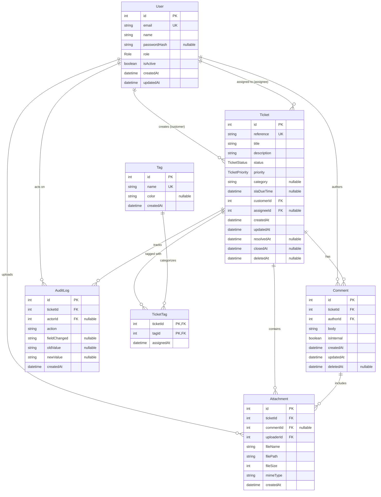

# SupportDesk — Entity Relationship Diagram (ERD)

**Date:** 5 November 2026 / 6 November 2026
**Assignment:** Week 2, Day 2 (Day 8) — Database Design with AI
**Project:** SupportDesk Customer Support Ticket Management System
**Schema Implementation:** Prisma ORM (`apps/api/prisma/schema.prisma`) targeting PostgreSQL 16

---

## 1. Visual Entity Relationship Diagram

The diagram below reflects the active, production-ready relational architecture defined in `apps/api/prisma/schema.prisma`.

---

## 2. Cardinality and Foreign Key Rules

| Relationship | Type | Foreign Key | Cascade Behavior | Business Justification |
| :--- | :--- | :--- | :--- | :--- |
| **User $\rightarrow$ Ticket (Customer)** | One-to-Many (`1:N`) | `Ticket.customerId -> User.id` | `Restrict` | Prevents deleting customers with historical support tickets. |
| **User $\rightarrow$ Ticket (Assignee)** | One-to-Many (`1:N`) | `Ticket.assigneeId -> User.id` | `SetNull` | Allows tickets to remain intact if an agent is reassigned/removed. |
| **User $\rightarrow$ Comment** | One-to-Many (`1:N`) | `Comment.authorId -> User.id` | `Restrict` | Ensures conversation provenance is never orphaned. |
| **User $\rightarrow$ Attachment** | One-to-Many (`1:N`) | `Attachment.uploaderId -> User.id` | `Restrict` | Retains file ownership attribution for audit compliance. |
| **User $\rightarrow$ AuditLog** | One-to-Many (`1:N`) | `AuditLog.actorId -> User.id` | `SetNull` | Retains system audit events even if the actor account is purged. |
| **Ticket $\rightarrow$ Comment** | One-to-Many (`1:N`) | `Comment.ticketId -> Ticket.id` | `Cascade` | Deleting a ticket purges all child thread comments. |
| **Ticket $\rightarrow$ Attachment** | One-to-Many (`1:N`) | `Attachment.ticketId -> Ticket.id` | `Cascade` | Deleting a ticket cleans up associated attachment records. |
| **Ticket $\rightarrow$ AuditLog** | One-to-Many (`1:N`) | `AuditLog.ticketId -> Ticket.id` | `Cascade` | Audit entries directly tied to a ticket lifecycle are purged on ticket hard delete. |
| **Ticket $\leftrightarrow$ Tag** | Many-to-Many (`N:M`) | Via `TicketTag(ticketId, tagId)` | `Cascade` on both FKs | Pure junction table with composite PK `(ticketId, tagId)`. |
| **Comment $\rightarrow$ Attachment** | One-to-Many (`1:N`) | `Attachment.commentId -> Comment.id` | `SetNull` | Preserves file attachments on ticket if a single comment is removed. |

---

## 3. Enumerated Types (Database Enums)

1. **`Role`**:
   - `customer`: End-users filing support tickets.
   - `agent`: Support engineers handling triage, updates, and resolutions.
   - `admin`: Administrators managing users, assignments, and system settings.

2. **`TicketStatus`**:
   - `open`: Newly created ticket awaiting triage or agent assignment.
   - `in_progress`: Ticket is actively being worked on by an agent.
   - `waiting_on_customer`: Ticket is paused awaiting customer response.
   - `resolved`: Issue resolved by agent, awaiting confirmation or closure.
   - `closed`: Ticket archived and permanently closed.

3. **`TicketPriority`**:
   - `P1`: Critical blocker / complete system outage.
   - `P2`: Major issue with significant business impact.
   - `P3`: Normal operational request or standard defect.
   - `P4`: Low-priority enhancement or general question.

---

## 4. Query Performance Indexes

1. `tickets(customerId)`: Customer portal query `WHERE customer_id = ? ORDER BY created_at DESC`.
2. `tickets(assigneeId, status)`: Agent queue dashboard `WHERE assignee_id = ? AND status = 'open'`.
3. `tickets(status, priority)`: Multi-column queue sorting for triage escalations.
4. `comments(ticketId, createdAt)`: Single index scan for rendering ordered ticket threads.
5. `ticket_tags(tagId)`: Reverse index for tag-based ticket filtering.
6. `attachments(ticketId)`: Fast file lookup for ticket attachments panel.
7. `audit_logs(ticketId, createdAt)`: Chronological audit history reconstruction.
